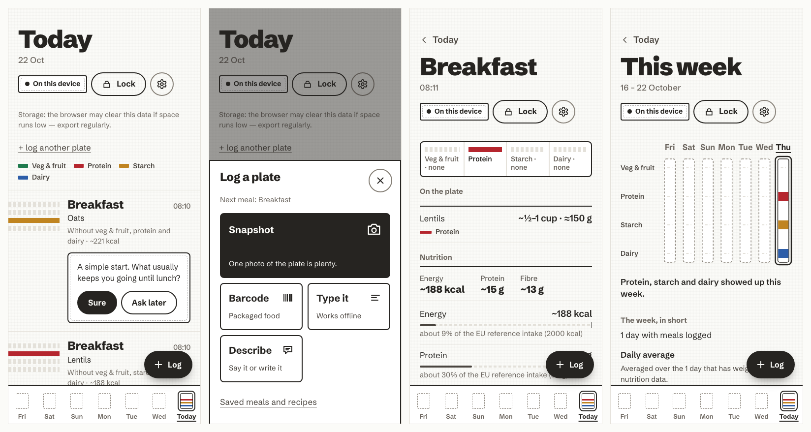
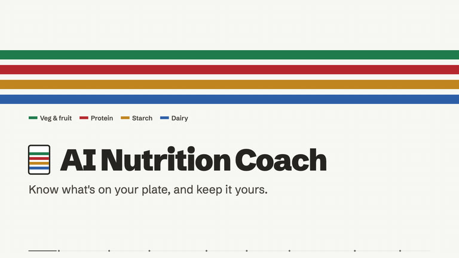
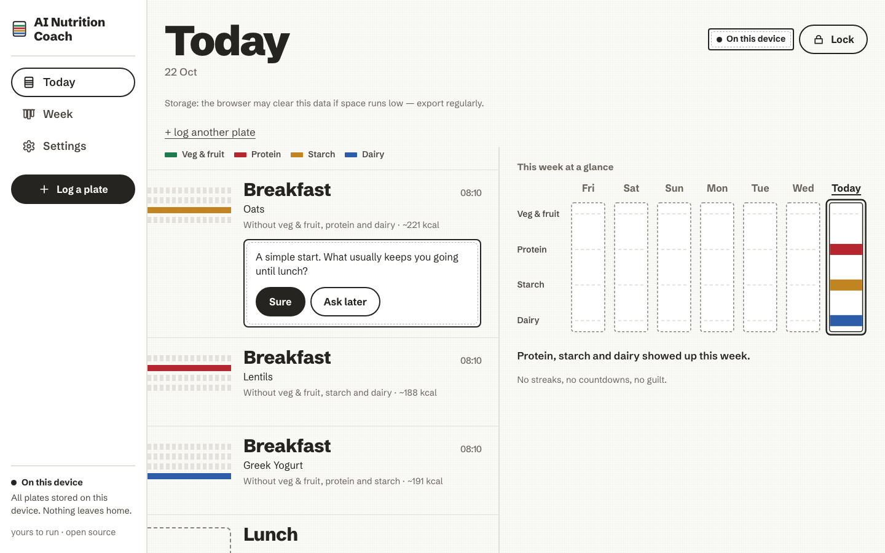

<p align="center">
  
</p>

<h1 align="center">AI Nutrition Coach</h1>

<p align="center">
  <strong>Know what is on your plate. Keep it to yourself.</strong><br>
  A calm, offline-first meal log that shows real grams and nutrients, asks one kind question instead of
  passing a verdict, and keeps your history encrypted on your own device.
</p>

<p align="center">
  <a href="./LICENSE"></a>
  <a href="./docs/self-host.md"></a>
  <a href="./docs/telemetry-posture.md"></a>
  <a href="./docs/pwa.md"></a>
  <a href="#languages"></a>
  <a href="https://github.com/mmornati/ai-nutrition-coach/actions/workflows/ci.yml"></a>
</p>

<p align="center">
  <a href="./docs/getting-started.md"><strong>Get started</strong></a> ·
  <a href="./docs/features.md">Feature tour</a> ·
  <a href="./docs/security.md">How it is secured</a> ·
  <a href="./docs/self-host.md">Self-host</a> ·
  <a href="./docs/faq.md">FAQ</a> ·
  <a href="https://mmornati.github.io/ai-nutrition-coach/">Documentation site</a>
</p>

<p align="center">
  
</p>

<p align="center">
  <a href="https://mmornati.github.io/ai-nutrition-coach/video/"></a><br>
  <a href="https://mmornati.github.io/ai-nutrition-coach/video/"><strong>Watch the short tour</strong></a> (1 min 20, narrated, subtitled) ·
  <a href="https://mmornati.github.io/ai-nutrition-coach/docs/videos/">how-to episodes</a> ·
  <a href="https://mmornati.github.io/ai-nutrition-coach/">the website</a>
</p>

---

## The day as a kitchen towel

Each meal weaves one band across the day. Every food group on the plate is a dyed stripe in a fixed order:
**veg and fruit** in green, **protein** in red, **starch** in ochre, **dairy** in blue. A group that is not there
leaves bare cotton. You read balance at a glance, from which stripes a band carries, never from a score, a ring or
a countdown. Tap a band and the numbers are there, plainly: grams per food, energy, protein, fibre, sugars, salt and
the rest, set against the EU reference intakes.

The week is seven towels hung side by side. The coach reads them with you and asks a question. Dismissing it costs
nothing.

## Why it is different

|     |     |
| --- | --- |
| **Real numbers, no pressure** | Grams and nutrients per plate and per day, as plain values and neutral bars against EU reference intakes, or a daily guide tuned by your optional profile. No streaks, badges, points, countdowns, "calories remaining" or red "over budget" states. Numbers can be hidden in one switch if they feel stressful. |
| **Yours, not ours** | No account. Your history lives in an encrypted database in your browser, opened by a passphrase only you know. The server serves the app and holds none of your data. |
| **Proved, not promised** | Every trust claim below names the test that proves it, and a release gate fails the build if a proof goes missing. |
| **AI is optional** | The no-AI app is complete: type it, describe, paste a recipe, the coach's questions and the week review all run on the device, offline. Add your own key, or use the AI your server's operator offers, when you want photo recognition or a coach that writes. |
| **Never fails the log** | Offline, no AI, an unknown barcode: the meal still lands, with the closest matches and a quantity you can adjust. |
| **One command to run it** | `bin/ai-nutrition-coach up`, or pull the published image from `ghcr.io`. Hardened container, strict CSP, no outbound need. |

## What it does

<table>
  <tr>
    <td width="50%" valign="top">
      <h3>Log in the moment</h3>
      <ul>
        <li><b>Snapshot</b> a plate; your AI suggests the foods and grams, you review them</li>
        <li><b>Barcode</b> scan, decoded on the device, looked up on Open Food Facts</li>
        <li><b>Type it</b> with ranked matches, portion presets and your recent foods, offline</li>
        <li><b>Describe</b> a meal in words or by voice ("two eggs, toast, a coffee with milk")</li>
        <li><b>Paste a recipe</b>'s text; the ingredients are matched to the food list</li>
        <li><b>Saved meals and recipes</b>, log a plate again, copy a whole day to today</li>
      </ul>
    </td>
    <td width="50%" valign="top">
      <h3>Understand, calmly</h3>
      <ul>
        <li><b>Day Board</b>: one woven band per meal, food groups at a glance</li>
        <li><b>Nutrition</b>: energy, protein, carbohydrate, sugars, fat, saturated fat, fibre, salt, against EU reference intakes</li>
        <li><b>This week</b>: seven towels, daily averages, a short rule-based review</li>
        <li><b>The coach asks</b> a question, never a verdict; with AI and your yes, it writes notes and answers in <b>Ask the coach</b></li>
        <li><b>Optional profile</b> (age range, activity, goal, diet, allergies) tunes the daily guide</li>
        <li>About 3,500 generic foods from the <b>CIQUAL</b> table, shipped with the app</li>
      </ul>
    </td>
  </tr>
  <tr>
    <td width="50%" valign="top">
      <h3>Own your data</h3>
      <ul>
        <li><b>Encrypted local store</b> (SQLite3 Multiple Ciphers, ChaCha20-Poly1305), key from your passphrase</li>
        <li><b>Auto-lock</b> after an idle delay; the key is dropped on lock</li>
        <li><b>Encrypted backup file</b> (Argon2id, AES-256-GCM) and <b>restore</b>, merged into your store</li>
        <li><b>Export</b> to CSV or JSON, offline</li>
        <li>Delete one plate, or <b>erase everything</b> in one place</li>
        <li>An in-app page saying exactly what is stored and what is sent</li>
      </ul>
    </td>
    <td width="50%" valign="top">
      <h3>Run it your way</h3>
      <ul>
        <li><b>Installable PWA</b> on iPhone, Android and desktop; works offline once loaded</li>
        <li><b>AI tiers</b>: No AI (default), your own OpenAI-compatible key, or this server's AI</li>
        <li><b>Self-host</b> with one command: loopback, automatic HTTPS (Caddy), or behind Traefik and Authentik</li>
        <li><b>Published image</b> on <code>ghcr.io</code>, scanned and smoke-tested before it is pushed</li>
        <li><b>English and French</b>, following your device until you choose</li>
        <li>Accessibility floor checked on every screen (names, roles, contrast, 48 px targets)</li>
      </ul>
    </td>
  </tr>
</table>

The full tour, screen by screen: [`docs/features.md`](./docs/features.md).

<p align="center">
  
</p>

## Quickstart

**Run it** (Docker on your machine):

```sh
git clone https://github.com/mmornati/ai-nutrition-coach.git && cd ai-nutrition-coach
bin/ai-nutrition-coach up            # builds and serves http://localhost:8080 (loopback only)
```

Open `http://localhost:8080/` and choose a passphrase. That passphrase creates your encrypted store; it cannot be
recovered, so keep it somewhere safe. Log your first plate with the **Log** button.

**Use it on your phone**: the browser store needs HTTPS (or localhost), so serve it with a domain:

```sh
AI_NUTRITION_COACH_DOMAIN=plate.example.com bin/ai-nutrition-coach up --tls       # automatic HTTPS (Caddy)
AI_NUTRITION_COACH_DOMAIN=plate.example.com bin/ai-nutrition-coach up --traefik   # behind your own Traefik
```

Then open the address on the phone and add it to the home screen *before* you start logging. Prefer the published
image? `AI_NUTRITION_COACH_IMAGE_TAG=ghcr.io/mmornati/ai-nutrition-coach:edge`, then `docker compose pull && docker compose up -d`.

Step by step, including install on iPhone and Android, the first passphrase and the first plate:
[`docs/getting-started.md`](./docs/getting-started.md). Every deployment option: [`docs/self-host.md`](./docs/self-host.md)
and [`docs/pwa.md`](./docs/pwa.md).

## Documentation

| | |
| --- | --- |
| [Getting started](./docs/getting-started.md) | Run it, install it on a phone, first passphrase, first plate, build from source |
| [Feature tour](./docs/features.md) | Every screen and what it does |
| [How it is secured](./docs/security.md) | The short version of the data, network and AI posture, with links to the detail |
| [FAQ](./docs/faq.md) | Short answers to the usual questions |
| [Your data](./docs/your-data.md) | The encrypted store, backups, exports, erase, shared devices |
| [AI tiers](./docs/ai-tiers.md) | No AI, your own key, this server's AI; exactly what is sent |
| [Telemetry posture](./docs/telemetry-posture.md) | What is on by default (nothing) and every user-enabled path |
| [Self-host](./docs/self-host.md) · [PWA](./docs/pwa.md) | Deploying, HTTPS, Traefik, Authentik, the published image, updates |
| [No-Dark-Patterns Standard](./docs/no-dark-patterns-standard.md) · [Accessibility](./docs/accessibility.md) · [Adults only](./docs/adults-only.md) | The product rules the gates enforce |
| [Encrypted sync plan](./docs/encrypted-sync-plan.md) | The plan for a relay and cross-device sync (not built yet) |

## Trust posture

Every promise below names the test that proves it (`Proof`).
`pnpm check:release-posture` (part of `pnpm verify`) fails if a row has no proof, if a named
file does not exist, is not a `*.test.*` / `*.spec.*` file, or contains no real, un-skipped
test. A shell script may stand beside the tests (the container egress test
`scripts/smoke_self_host.sh`, which the `self-host` job of the `ci` workflow runs) only if it exists and a
workflow invokes it. Unit tests (`apps/web/src`, `packages/core/test`) and the gate self-tests
(`tools/gates`, `tools/pwa`) run in `pnpm verify`; the Playwright specs (`apps/web/e2e`,
Chromium and WebKit) run in CI via `pnpm e2e`, and `tools/webkit_smoke/smoke.spec.mjs` is the
smoke of the production image (`scripts/webkit_smoke.sh`, the `image` job of the `ci` workflow).

| Promise | Where it lives | Proof |
| ------- | -------------- | ----- |
| Local encrypted store (sqlite3mc, key derived from your passphrase): the stored file is not plaintext SQLite, a wrong passphrase cannot open it, the key is dropped on lock, erase removes every byte. The browser adapters (OPFS worker, IndexedDB header copy, `localStorage`) are proved in Chromium and WebKit by the e2e spec, not on real devices: Safari / Firefox are untested | AD-8, ADR-0002 — [`docs/your-data.md`](./docs/your-data.md) | `apps/web/src/storage/sqlite-engine.test.ts`, `apps/web/src/storage/store-controller.test.ts`, `apps/web/e2e/storage.spec.ts` |
| Exporter: CSV/JSON offline, no account | AD-9 | `apps/web/src/export/csv-exporter.test.ts`, `apps/web/src/export/json-exporter.test.ts`, `apps/web/src/export/web-export-destination.test.ts` |
| Sync is a seam only: in-memory outbox, no transport yet; the UI says "on this device", never "synced" | AD-6 | `apps/web/src/sync/sync.test.ts`, `packages/core/test/sync.test.ts`, `apps/web/src/components/day/StatusChip.test.tsx` |
| Photos sent to your AI endpoint are metadata-stripped, consent is per host (and per photo by default), the key is bound to its host | N1 — [`docs/ai-tiers.md`](./docs/ai-tiers.md) | `apps/web/src/capture/photo-sanitizer.test.ts`, `apps/web/src/ai/consent.test.ts`, `apps/web/src/ai/ai-settings.test.ts`, `apps/web/src/ai/byok-ai-rung.test.ts` |
| One-command self-host: hardened static container, strict CSP, no outbound need | FR-11 — [`docs/self-host.md`](./docs/self-host.md) | `tools/pwa/infra.test.mjs`, `apps/web/e2e/csp.spec.ts`, `scripts/smoke_self_host.sh` |
| Installable, offline-capable web app: our own service worker precaches a checksummed manifest, never intercepts cross-origin or non-GET requests, never caches at run time, and waits for you to tap *Reload* before a new version takes over. The worker is executed by `sw.behaviour.test.mjs` and, in real browsers, by `e2e/pwa.spec.ts`; the production-image run is the opt-in `scripts/webkit_smoke.sh` | ADR-0003 — [`docs/pwa.md`](./docs/pwa.md) | `tools/pwa/precache.test.mjs`, `tools/pwa/sw.behaviour.test.mjs`, `apps/web/src/pwa/app-update.test.ts`, `apps/web/src/components/shell/UpdatePrompt.test.tsx`, `apps/web/e2e/pwa.spec.ts` |
| The AI key and settings live inside the encrypted store, never in `localStorage`; the last-export date and the quiet export suggestion are encrypted too | ADR-0003 — [`docs/ai-tiers.md`](./docs/ai-tiers.md), [`docs/your-data.md`](./docs/your-data.md) | `apps/web/src/storage/store-controller.test.ts`, `apps/web/src/ai/ai-settings.test.ts`, `apps/web/src/screens/settings/YourDataScreen.test.tsx` |
| Per-plate delete & privacy page: remove one plate (and its coach note) after a calm confirm, reachable by screen reader too; a one-time "About this app" notice and a one-time Open Food Facts notice, both kept in the encrypted store; an in-app page saying what is stored and sent; photos ask before **every** upload by default | PV1 / PV5 / PV7 — [`docs/your-data.md`](./docs/your-data.md) | `packages/core/test/delete-plate.test.ts`, `apps/web/src/screens/plate/PlateScreen.test.tsx`, `apps/web/src/screens/settings/PrivacyScreen.test.tsx`, `apps/web/src/screens/about/AboutNotice.test.tsx`, `apps/web/src/catalog/privacy-prefs.test.ts`, `apps/web/src/ai/consent.test.ts` |
| What leaves the device is pinned exactly: the AI request has a fixed key set, the Open Food Facts request is `GET /api/v2/product/<barcode>?fields=` with no Referer / Cookie, no log call can carry content, the browser blocks every other origin (CSP `connect-src`), and the self-host container logs no request (no User-Agent, address truncated) unless asked | PV2 / PV3 / PV9 — [`docs/telemetry-posture.md`](./docs/telemetry-posture.md) | `apps/web/src/ai/openai-compatible-provider.test.ts`, `apps/web/src/catalog/off-barcode-source.test.ts`, `tools/gates/log-hygiene.test.mjs`, `apps/web/e2e/csp.spec.ts`, `tools/pwa/infra.test.mjs` |
| Zero telemetry by default; only user-enabled network paths (an import-based gate over the TypeScript AST, run by `pnpm check:telemetry`) | FR-12 — [`docs/telemetry-posture.md`](./docs/telemetry-posture.md) | `tools/gates/telemetry.test.mjs` |
| Adults-only: no biometric API, no under-13 / teen / parent profile machinery (`pnpm check:adults-only`) | FR-13 / FR-14 — [`docs/adults-only.md`](./docs/adults-only.md) | `tools/gates/adults-only.test.mjs`, `packages/core/test/managed-oversight-seam.test.ts` |
| No-Dark-Patterns Standard (no streaks, badges, countdowns, spinners, red) | FR-15 — [`docs/no-dark-patterns-standard.md`](./docs/no-dark-patterns-standard.md) | `apps/web/src/no-dark-patterns.test.ts`, `tools/gates/release-posture.test.mjs` |
| Every screen meets the accessibility floor (axe: names, roles, contrast, target size) in jsdom and in a real browser | NFR-7 — [`docs/accessibility.md`](./docs/accessibility.md) | `apps/web/src/a11y-floor-gate.test.ts`, `apps/web/src/screens/today/TodayScreen.test.tsx`, `apps/web/e2e/gallery.spec.ts` |

What is *not* proven yet (real-device Safari and Chrome, Firefox) is listed under
[Known accepted gaps](#known-accepted-gaps) below and in
`_bmad-output/review/security-and-quality-review-2026-10-01.md`.

## Known accepted gaps

Stated, not hidden (details in [`docs/migration/parity-checklist.md`](./docs/migration/parity-checklist.md) and
[`docs/your-data.md`](./docs/your-data.md#browser-coverage-and-known-accepted-gaps)):

- Firefox is untested; Safari and Chrome are proved with Playwright's WebKit and Chromium, not on real devices.
- Without the Web Locks API there is no tab exclusion (two tabs can open the same store).
- Exports are plaintext files you hold, and a CSV or JSON export cannot be imported (the encrypted backup file can be
  restored).
- Devices shared by several people see one history.
- There is no live sync between devices yet. If the server you got the app from runs the optional relay, an
  encrypted copy can be kept there (restore on a new device, join a device that has data of its own; the copy
  updates itself), but another device's changes only arrive when you next connect or upload, and the "synced"
  chip is not lit ([plan](./docs/encrypted-sync-plan.md), phase S3). On iPhone, an installed app keeps its data
  apart from Safari's.
- The hosted free-quota AI tier is not built (bring your own key, or use the AI your server offers); the local-model
  tier is a seam for a later version.
- The Tip jar is pending the named reviewer.
- There is one theme, the light "Torchon" world; there is no dark theme.

## Languages

The app speaks English and French (Français). It follows your device's language until you choose:
**Settings → Language** offers *Match my device*, *English* and *Français*. The choice is stored in
the encrypted local store with the rest of your settings, plus a plain `localStorage` hint (the
language code only) so the passphrase and unlock screens can show it before the store is open.
"Erase all local data" removes both. Adding a language is described in
[`CONTRIBUTING.md`](./CONTRIBUTING.md#adding-a-language).

## Contributing

Contributions are welcome. [`CONTRIBUTING.md`](./CONTRIBUTING.md) has the build, test and smoke commands, the gate
frequency, how to make and prove a trust claim, and where things live in the repository. The release posture is
enforced by [`docs/release-checklist.md`](./docs/release-checklist.md). To report a vulnerability, see
[`SECURITY.md`](./SECURITY.md).

```sh
pnpm install && pnpm dev     # the React PWA in a Vite dev server (Node 24, pnpm 11.14.0 via corepack)
pnpm verify                  # the one gate: format, lint, types, tests, posture gates, build, bundle scans
```

## License

MIT, see [`LICENSE`](./LICENSE). AI Nutrition Coach was formerly called OpenPlate.

<p align="center"><sub>yours to run · open source</sub></p>

<p align="center">
  
</p>
