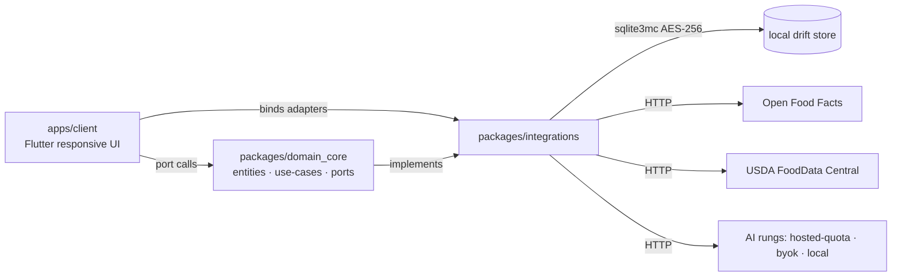
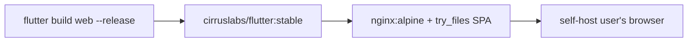

# Architecture Spine — OpenPlate v1

## Design Paradigm

**Hexagonal ports-and-adapters** with a single pure-Dart **domain core** consumed by one responsive Flutter client (iOS, Android, web). Domain rules, entities, and the coach taxonomy live in the core and know nothing of Flutter, SQLite, or HTTP. Every outside concern — the local encrypted store, OFF/USDA, AI tiers, sync, export, barcode, camera — sits outside the core as an adapter bound to a core port. The no-AI core is a complete product; AI tiers are swappable adapters behind one port, never branches inside the core.

```text
apps/client/              # Flutter app — iOS + Android + web (one responsive codebase)
packages/domain_core/     # pure Dart: entities, use-cases, ports, coach taxonomy
packages/integrations/    # adapters: drift store, OFF/USDA, AI tiers, sync, export
infra/                    # Docker/nginx self-host definition for the web build
```

## Invariants & Rules

### AD-1 — Shared pure-Dart domain core; shells are thin [ADOPTED]

- **Binds:** `all` capabilities; every FR.
- **Prevents:** the divergence where mobile and web apps grow two independent domain models and rule sets.
- **Rule:** Domain entities, use-cases, and the coach model live in `packages/domain_core`, a pure-Dart package with **no Flutter, SQLite, or HTTP imports**. `apps/client` and `packages/integrations` may depend on it; it depends on nothing. UI code never imports drift/dio/mobile_scanner directly — only through ports.

### AD-2 — One responsive Flutter codebase for all three targets [ADOPTED]

- **Binds:** PRD §4.5, FR-11, FR-12; UJ-1..UJ-5.
- **Prevents:** building the self-host web client and the mobile apps as separate apps with separate logic paths.
- **Rule:** `apps/client` is a single Flutter app whose layout responds to form factor (the UX spines' responsive mocks). `flutter build web` serves the self-host client; iOS/Android targets ship the same app. Desktop is deferred (PRD §6.2) — not a separate codebase.

### AD-3 — Local encrypted store is the single source of truth

- **Binds:** FR-9, FR-10, FR-5, SM-3; Day Board, Expanded plate, status chips.
- **Prevents:** phantom or divergent state — two owners of a Plate Log, or UI state that disagrees with the store.
- **Rule:** Every domain mutation flows through a core use-case that commits to the store before any UI reflects it. UI state (Riverpod providers) is **derived** from store state, never a second source. Coach Question interactions (FR-5) are logged locally via the same path. Sync reads from the store and never writes outside it.

### AD-4 — One FoodCatalog port in front of OFF + USDA

- **Binds:** FR-1, FR-2, FR-3; Capture sheet, Expanded plate.
- **Prevents:** three separate lookup clients (photo path, barcode path, manual path) each owning its own copy of OFF/USDA logic and cache.
- **Rule:** A single core port `FoodCatalog` resolves barcodes, text queries, and recognized foods to Database Foods, with a local cache adapter in front of OFF/USDA. All three entry paths (photo, barcode, manual/voice) call the same port. Known barcode → food ≤2s; text → ranked matches with quantity presets (FR-3).

### AD-5 — AI is a swappable tier behind one port

- **Binds:** FR-6, FR-7, FR-8; Settings → Your AI; UJ-3, UJ-4.
- **Prevents:** provider-specific code leaking into the core, and FR-8's "provider-swappable" requirement rearchitecting the system later.
- **Rule:** One core port (the AI rung) exposes food recognition and coach-note enrichment behind an interface with exactly one active implementation chosen by config: `no-op` (the complete no-AI core), `hosted-quota` (free-model default, FR-6), `byok` (user's OpenAI-compatible key, FR-7), and `local` (reserved for v2, FR-8). The core never branches on which rung is active — only on whether a port call succeeded.

### AD-6 — Offline-first writes; sync is an adapter that never loses data

- **Binds:** FR-9, FR-10, UJ-5; status chips (·local / ·pending / ·synced).
- **Prevents:** the "lost my history" failure mode and duplicate/dropped Plate Logs on reconnection.
- **Rule:** Writes are always local-first and never wait on the network. A sync adapter drains a durable outbox queue to user-controlled infrastructure only (FR-10); retries silently on reconnection; a log is marked `synced` only after durable remote acknowledgment. No third-party sync. Chip state derives from queue state (AD-3).

### AD-7 — Coach copy lives in a localization/key store, reviewed against the No-Dark-Patterns Standard

- **Binds:** FR-4 NFR, FR-15; coach whisper, capture sheet, settings.
- **Prevents:** hardcoded ad-hoc coach strings and tone drift that break the No-Dark-Patterns gate.
- **Rule:** Every user-facing coach string (whispers, notes, quota notices) is a keyed, localized template in the key store, with no string interpolation in widgets. The No-Dark-Patterns Standard is a QA checklist gate in CI/review (FR-15 consequence); a named reviewer owns the pass.

### AD-8 — At-rest encryption is honest and platform-aware

- **Binds:** FR-9, FR-7 (key storage), UJ-3.
- **Prevents:** overclaiming "cannot be breached" on web, where OS keystores don't exist.
- **Rule:** Mobile: store encrypted with AES-256 via `package:sqlite3` sqlite3mc build-hook; the 32-byte DB key comes from `flutter_secure_storage` (Keychain/Keystore). Web: the same drift schema runs on sqlite3.wasm with a passphrase-derived key (PBKDF2) held in memory for the session only; the web client's weaker key-holding story is documented, never asserted as equivalent. A BYOK key is always stored via `flutter_secure_storage` and never leaves the device (FR-7).

### AD-9 — Export is a read-only port over the store

- **Binds:** FR-9 consequence (portable export), Settings → Your data, UJ-5.
- **Prevents:** export logic becoming a bespoke one-off that diverges from stored truth.
- **Rule:** A core port `Exporter` streams the store's Plate Logs to CSV/JSON on demand, read-only, from the single source of truth. Export is available offline and never requires an account.

## Consistency Conventions

| Concern | Convention |
| --- | --- |
| Naming (entities, files, interfaces, events) | Domain entities in `domain_core` (PlateLog, FoodEntry, DatabaseFood, CoachNote, CoachQuestion); ports named by role (`FoodCatalog`, `Exporter`, `AiRung`); files kebab-case; packages `snake_case`. |
| Data & formats (ids, dates, error shapes, envelopes) | Local DB ids: autoincrement ints; external refs: OFF barcode strings, USDA FDC id strings, kept verbatim on DatabaseFood. Dates: UTC ISO-8601, rendered in local time. Quantities: stored as honest ranges ("~2 fists", FR-1), never false-exact kcal. Errors: typed domain results (nearest-match, not-found, quota-exhausted), never raw exceptions crossing ports. |
| State & cross-cutting (mutation, errors, logging, config, auth) | Single mutation path through use-cases (AD-3); Riverpod providers read-only views; no account in v1 (single local identity); telemetry off by default in all shipped builds (FR-12); coach strings via key store (AD-7). |

## Stack

| Name | Version |
| --- | --- |
| Dart SDK | ^3.13.0 |
| Flutter | 3.47.0 |
| flutter_riverpod (codegen) | 3.4.2 |
| drift / drift_dev | 2.34.3 / 2.34.x |
| sqlite3 (+ sqlite3mc build hook) | 3.5.x |
| flutter_secure_storage | 11.0.0 |
| mobile_scanner | 7.4.0 |
| image_picker | 1.2.3 |
| dio | 5.11.0 |
| melos | 8.2.2 |
| patrol / patrol_cli | 4.8.0 / 4.6.1 |
| test / flutter_test / integration_test | SDK-bundled |

## Structural Seed

```text
openplate/
  apps/client/                # one Flutter app — iOS + Android + web (responsive)
  packages/domain_core/       # pure Dart hexagon: entities, use-cases, ports, coach taxonomy
  packages/integrations/      # adapters: drift store, OFF/USDA cache, AI rungs, sync, export
  infra/                      # Dockerfile (multi-stage) + nginx.conf for the self-host web build
  melos.yaml                  # workspace orchestration on Dart pub workspaces
```





## Capability → Architecture Map

| Capability / Area | Lives in | Governed by |
| --- | --- | --- |
| One-tap logging (FR-1..3) | `domain_core` use-cases + capture adapters | AD-1, AD-4 |
| Balanced-Plate Coach (FR-4, FR-5) | `domain_core` coach taxonomy + key store | AD-1, AD-7 |
| AI tier ladder (FR-6, FR-7, FR-8) | `integrations` AI rungs behind `AiRung` port | AD-5 |
| Local-first data (FR-9, FR-10) | `integrations` drift store + sync adapter | AD-3, AD-6, AD-8 |
| Self-host & OSS (FR-11, FR-12) | `apps/client` web build + `infra/` | AD-2 |
| Kid-smart design (FR-13, FR-14) | `domain_core` (no profiles in v1) | AD-1, PRD §4.6 |
| No-Dark-Patterns (FR-15) | key store + QA gate in CI | AD-7 |

## Deferred

- **Cross-device sync mechanism (FR-10):** v1-minimal per PRD — the adapter seam (AD-6) is reserved; the concrete path (self-host relay vs manual export/import) is an architecture decision left to the build, not fixed now.
- **Free-model quota provider (FR-6):** Cloudflare Workers AI vs Gemini free tier — an adapter selection behind AD-5, resolvable at build time without a core change.
- **Local model rung (FR-8):** v2; the `AiRung` port is the seam.
- **Managed-oversight profiles (FR-14):** v2, pending legal validation (PRD OQ4).
- **Desktop clients:** v2 — AD-2's one-codebase rule means a desktop target can be added without a new architecture.
- **OFF write-back / contribution (PRD OQ3):** v2 unless decided; a contribution adapter behind `FoodCatalog` can be added later.
- **Week coach summary (UX):** v1.5 surface, not an architecture dimension.
