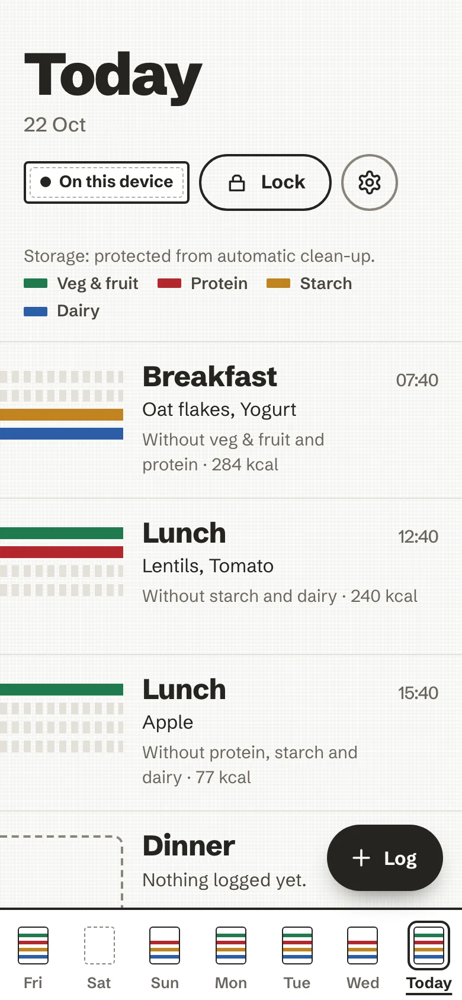
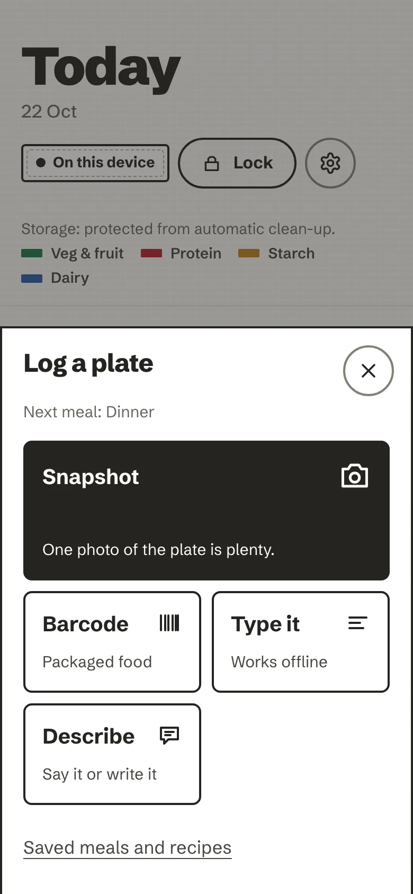
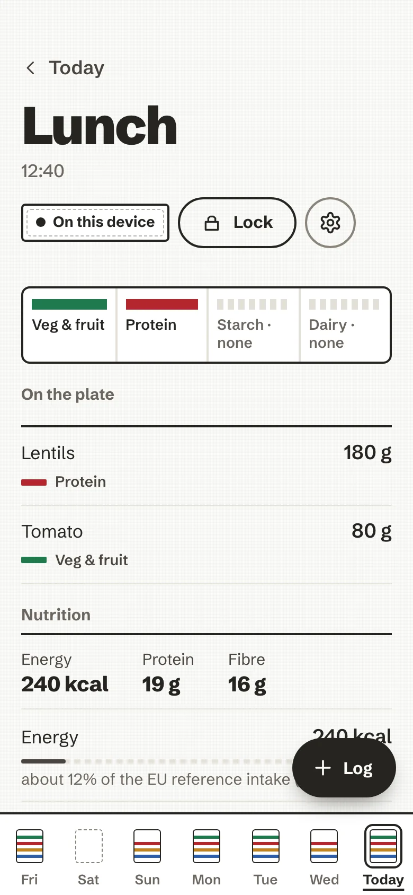
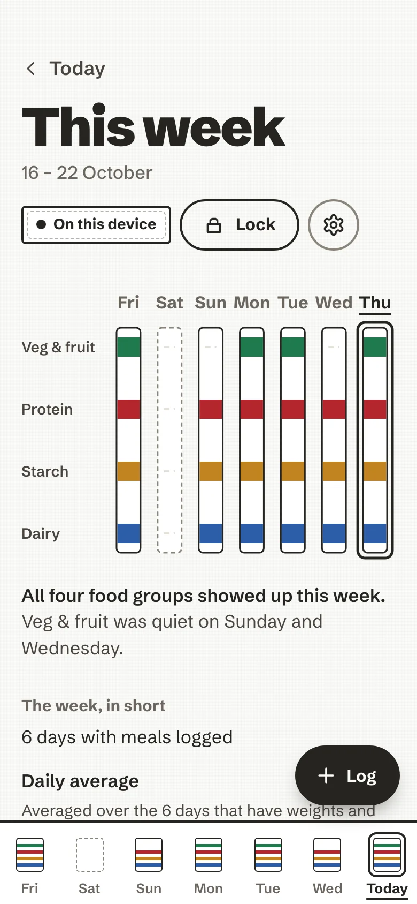
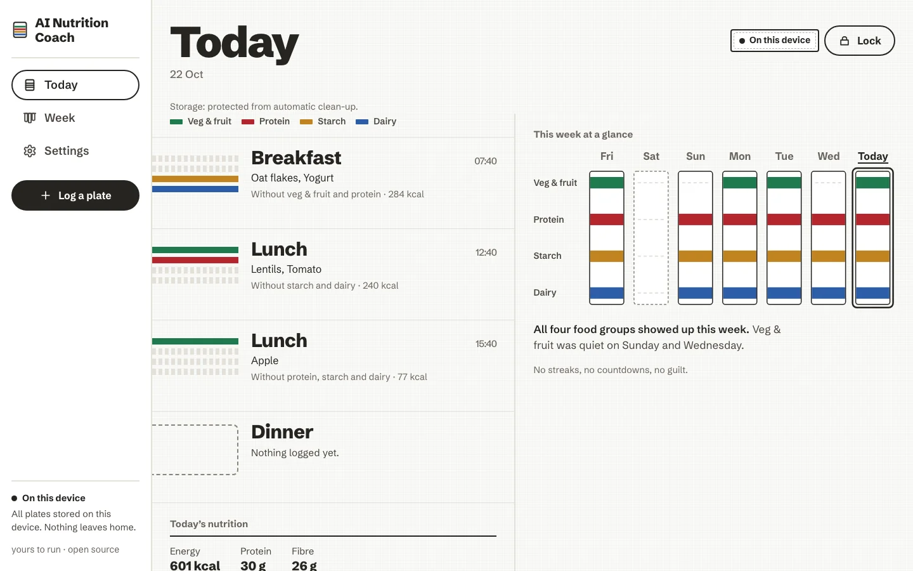

# What it does

A tour of AI Nutrition Coach as it is built today, one short section per part of the app, each with a link to the
page that tells the rest. Where something is planned rather than built, it says so.

<figure markdown>
{ loading=lazy }
<figcaption>Today, the Day Board.</figcaption>
</figure>
<figure markdown>
{ loading=lazy }
<figcaption>One sheet for every way in.</figcaption>
</figure>
<figure markdown>
{ loading=lazy }
<figcaption>A plate, with its numbers.</figcaption>
</figure>
<figure markdown>
{ loading=lazy }
<figcaption>The week as seven towels.</figcaption>
</figure>

## The look: a striped kitchen towel

The day is a towel laid on the table. Each meal weaves one band across it, and each food group on the plate is a dyed
stripe in a fixed order:

<ul class="anc-legend">
  <li class="veg">Veg and fruit</li>
  <li class="protein">Protein</li>
  <li class="starch">Starch</li>
  <li class="dairy">Dairy</li>
</ul>

A group that is missing leaves bare cotton, drawn as a dashed seam, never as a warning colour. Each dye means one food
group and always sits beside its name, so nothing rests on colour alone. When a plate is logged its stripes are woven
in from the left; under reduced motion they simply appear. The design system is
[DESIGN.md](https://github.com/mmornati/ai-nutrition-coach/blob/main/DESIGN.md).

## Logging a plate

**Log** opens one sheet with every way in, and you review foods and amounts before anything is saved. The meal always
lands: offline, without AI, or with an unknown barcode, you get the closest matches and a quantity to adjust.

| Way | In short |
| --- | --- |
| **Type it** | Ranked matches from the built-in food list and the CIQUAL table (about 3,500 generic foods), portion presets or grams. Works offline. |
| **Barcode** | Read on the device, looked up on Open Food Facts with only the barcode sent. |
| **Describe** | "Two eggs, toast with butter, a coffee with milk", written or, with an AI, said out loud. Without AI, matched on the device. |
| **Paste a recipe** | The ingredients or the whole text of a recipe page; nothing is fetched from the web. |
| **Snapshot** | One photo, with an AI you chose, after your yes; location and camera details are removed first. |
| **Saved meals and recipes** | A plate kept under a name, or a home recipe worked out per serving. |
| **Again and copy** | *Log this again* on any plate, or *Copy this day to today*. |

All of it, step by step: [Log a plate](guide/log-a-plate.md).

## The day and the week

**Today** stacks the day's plates as bands, with the time, the foods, the groups that are missing and an approximate
energy figure. On a phone, the week sits folded in the dock; on a computer, a rail and *This week at a glance* sit
beside the day. Tap a band for the plate: each food with its grams, and its nutrients.

**This week** hangs seven towels side by side, says in a sentence which groups showed up and which stayed quiet, and
adds *The week, in short*: days logged, daily averages and a few remarks worked out on the device.

More: [Your day and your week](guide/day-and-week.md).

<figure class="anc-wide" markdown>
{ .anc-desktop loading=lazy }
<figcaption>On a computer.</figcaption>
</figure>

## Nutrition numbers

Grams per food, and for each plate and each day: energy, protein, carbohydrate, sugars, fat, saturated fat, fibre and
salt. Each value comes with a neutral bar and a sentence, for example "about 9% of the EU reference intake (2000
kcal)". Estimates are marked `~`; unknown values are left empty, never shown as zero. An optional profile tunes the
daily guide, and one switch hides the numbers if they feel stressful. Open Food Facts' Nutri-Score and NOVA can appear
as information about a product, never as a score of you.

More: [Nutrients, against the EU reference intakes](guide/day-and-week.md#nutrients-against-the-eu-reference-intakes).

## The coach

The coach asks rather than tells. After a plate it may offer one question, with *Sure* and *Ask later*; dismissing it
costs nothing, and it never asks the same question twice. The built-in questions and the week's remarks are rules on
the device and need no AI. With an AI and a separate yes, it can also write its notes, answer questions about your
last seven days, and write a paragraph about the week. Every AI text is checked before it is shown, and a question
about an eating worry or a symptom is answered on the device and never sent.

More: [The coach](guide/coach.md).

## AI, only if you want it

Exactly one AI choice is active at a time, in *Settings → Your AI*:

| Choice | Status |
| --- | --- |
| **No AI** | The default, always available, nothing sent |
| **My own key** | Built: any OpenAI-compatible endpoint, your key, kept in the encrypted store and bound to its host |
| **Provided by this server** | Built: offered only when the operator set one shared key on the server; the key never reaches the browser |
| Free model (hosted quota) | Planned, not built: it needs a server-side relay |
| Model on this device | Planned, not built |

Photos, *Describe* and coaching each have their own consent, recorded for one destination and cleared when the
destination changes. More: [Your AI](guide/your-ai.md), and every field of every request in
[AI tiers, in detail](ai-tiers.md).

## Your data

An encrypted store in your browser, opened by a passphrase only you know; a lock that closes it; an encrypted backup
file you can restore on another device; plain CSV and JSON exports; and an erase that means it. The in-app privacy
page lists what is stored, what is sent, and to whom.

More: [Back up, export, erase](guide/your-data.md) and [How it is secured](security.md).

## Install, offline and updates

An installable web app on iPhone, Android and a computer, with its own icon and no browser bars. After the first
load it opens without a connection. A new version waits for you: "A new version is ready", *Reload* or *Later*.

More: [Settings, Install on your phone](guide/settings.md#install-on-your-phone) and [The installable app](pwa.md).

## Languages

English and French, following your device until you choose. AI texts follow the app's language.
More: [Languages](guide/languages.md).

## Run your own

One command (`bin/ai-nutrition-coach up`), automatic HTTPS through Caddy or behind your own Traefik, or the published
image on `ghcr.io`. The container is non-root and read-only, holds no data and makes no outbound calls of its own.
More: [Self-host](self-host.md).

## Accessibility and the no-dark-patterns rules

- Every screen is checked against an accessibility floor (names, roles, contrast, 48 px targets) in tests and in a
  real browser. Sizes are in rem and follow the browser's text size. See [Accessibility](accessibility.md).
- The [No-Dark-Patterns Standard](no-dark-patterns-standard.md) is binding and enforced by tests: no streaks, badges,
  points, countdowns, celebratory pop-ups, red guilt states or spinners. Numbers are allowed; pressure is not.
- Adults only: no child or teen profiles, no biometric API ([Adults only](adults-only.md)).

## Not built yet

- **Sync between devices.** Each browser is its own store. An encrypted relay where the server holds only ciphertext
  is planned in phases; the groundwork and the encrypted backup file are done, the relay is not
  ([the roadmap](https://github.com/mmornati/ai-nutrition-coach/blob/main/docs/encrypted-sync-plan.md)).
- **The hosted free AI quota** and **a model on the device**.
- **The tip jar**, pending its named reviewer.
- **A dark theme.**

The complete list of accepted gaps is in the
[README](https://github.com/mmornati/ai-nutrition-coach/blob/main/README.md#known-accepted-gaps).
