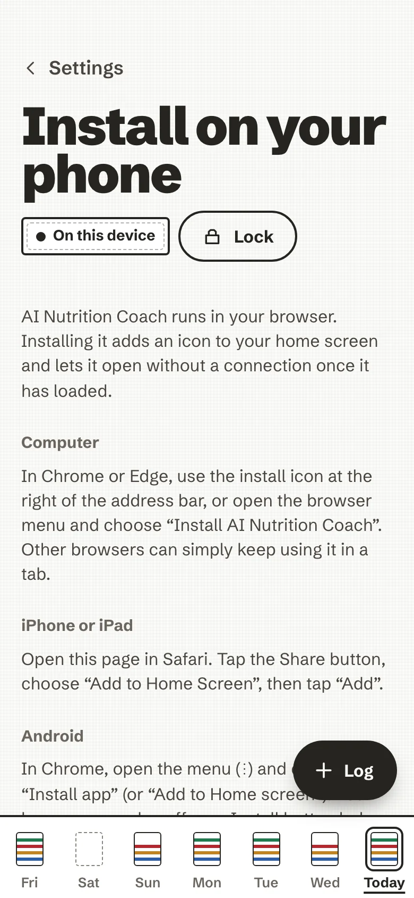
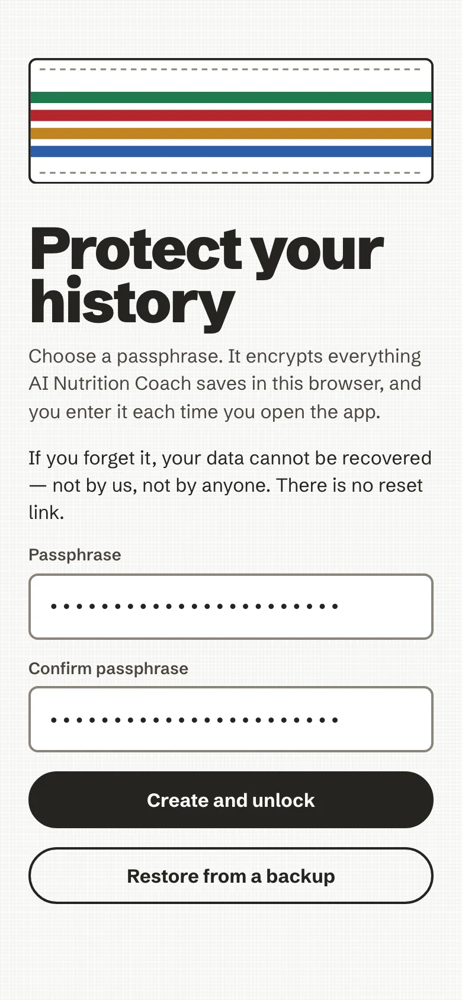
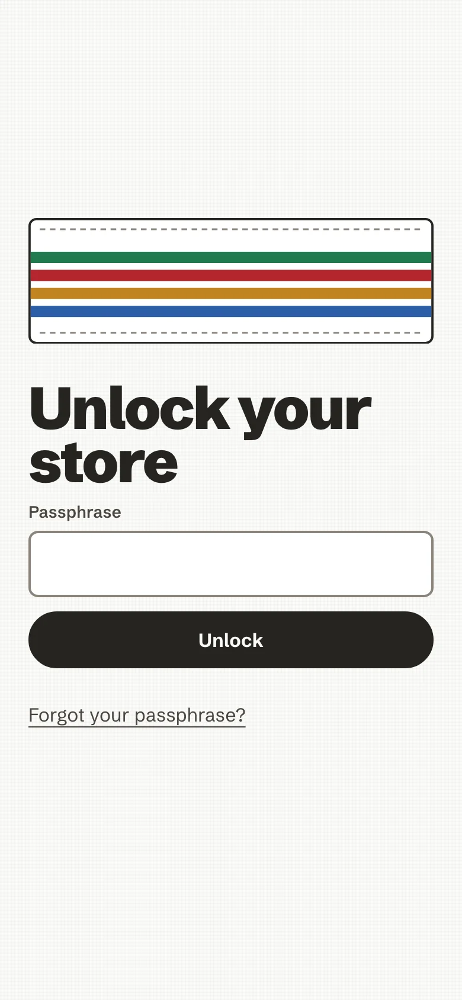

# Your first plate

From nothing to your first plate in a few minutes. AI Nutrition Coach is an installable web app (a PWA): one small
container serves it, you open its address in a browser and add it to your home screen. There is no account and no
sign-up; your history is encrypted in the browser you use.

!!! tip "Someone already runs it for you?"
    If a family member or a friend gave you an address, skip to [3. Install it](#3-install-it). Steps 1 and 2 are for
    whoever runs the server.

<!-- anc-video:first-run -->
<div class="anc-in-video">
  <a class="anc-video__poster" href="/ai-nutrition-coach/video/first-run/" tabindex="-1" aria-hidden="true"></a>
  <div>
    <p class="anc-in-video__label">In video</p>
    <p class="anc-in-video__title"><a href="/ai-nutrition-coach/video/first-run/">Your first plate</a></p>
    <p class="anc-muted">Install it, choose a passphrase, log a meal.</p>
  </div>
</div>
<!-- /anc-video -->

## 1. Run it

You need Docker. From a clone of the repository:

```sh
git clone https://github.com/mmornati/ai-nutrition-coach.git && cd ai-nutrition-coach
bin/ai-nutrition-coach up        # builds the image, serves http://localhost:8080/ (this machine only)
bin/ai-nutrition-coach down      # stops and removes it
```

Prefer not to build? Every commit on `main` that passed its checks is published to the GitHub Container Registry.
Set the image and pull it instead:

```sh
AI_NUTRITION_COACH_IMAGE_TAG=ghcr.io/mmornati/ai-nutrition-coach:edge
docker compose pull && docker compose up -d
```

The tags (`:edge`, releases, one exact commit) are listed in [`self-host.md`](./self-host.md#run-the-published-image-instead-of-building).

The container only serves the app. It stores no data and runs as a non-root user on a read-only filesystem.

## 2. Reach it from your phone

The encrypted store, the camera and offline use all need a secure page: `https://…` or `http://localhost`. Plain
HTTP over your network is not supported, on purpose. Give the app a domain name and let the bundled Caddy profile
fetch a certificate:

```sh
AI_NUTRITION_COACH_DOMAIN=plate.example.com bin/ai-nutrition-coach up --tls
```

Already running Traefik? Use `up --traefik` instead (no port is published). Family-only access, Authentik forward
auth and Cloudflare Tunnel are covered in [`self-host.md`](./self-host.md) and [`pwa.md`](./pwa.md#deploy-behind-traefik).

## 3. Install it

Open the HTTPS address on the phone first, and install **before** you start logging: on iPhone an installed app keeps
its data apart from Safari's.

- **iPhone or iPad (Safari):** Share, then *Add to Home Screen*, then *Add*.
- **Android (Chrome):** the menu, then *Install app* (or *Add to Home screen*).
- **Desktop (Chrome or Edge):** the install icon at the right of the address bar.

<figure markdown>
{ .anc-phone loading=lazy }
<figcaption>Settings, Install on your phone, repeats these steps.</figcaption>
</figure>

*Settings → Install on your phone* in the app repeats these steps. Once it has loaded once, it opens without a
connection. When a new version is ready, a calm line says so; tap *Reload* when it suits you.

## 4. Choose a passphrase

The first screen asks you to protect your history. Type a passphrase twice (at least 10 characters, with a few
different ones; longer is better). It derives the key that encrypts your store, and it is never written anywhere.

<div class="anc-shots" markdown>
<figure markdown>
{ loading=lazy }
<figcaption>The first screen: choose a passphrase.</figcaption>
</figure>
<figure markdown>
{ loading=lazy }
<figcaption>Every visit after that starts here.</figcaption>
</figure>
</div>

**A forgotten passphrase cannot be recovered.** There is no copy, no reset link and no escrow. Keep it in a password
manager.

After that, every visit starts with an unlock screen. The app locks itself after an idle delay (15 minutes by
default; 5, 15, 30 or 60 in *Your data*) and when the page has been hidden for 5 minutes. The *Lock* button does
it at once.

Already have an encrypted backup from another device? Choose *Restore from a backup* on the same screen.

## 5. Log your first plate

Press **Log**. Pick the way that suits the moment:

| Way | When it helps |
| --- | --- |
| **Type it** | Search the food list (works offline), pick a portion preset or grams |
| **Barcode** | A packaged product; the code is read on the device and looked up on Open Food Facts |
| **Describe** | Write or say "two eggs, toast with butter, a coffee with milk" |
| **Snapshot** | A photo of the plate, when an AI is connected |
| **Saved meals and recipes** | Something you eat often, or a dish you cook |

Review the foods and amounts, confirm, and the meal lands on **Today** as a woven band: one dyed stripe for each food
group on the plate. Tap it to see the foods, the grams and the nutrients against the EU reference intakes. The coach
may ask a question underneath; *Ask later* is always fine.

Every way in, step by step, is in [Log a plate](guide/log-a-plate.md); the day, the plate and the week are in
[Your day and your week](guide/day-and-week.md).

## 6. Optional: connect an AI

The app is complete without AI. An AI adds photo recognition, a smarter *Describe*, and, if you also say yes to
coaching, notes written by the AI and *Ask the coach*. Open *Settings → Your AI*:

- **My own key**: any OpenAI-compatible endpoint and model, with your API key. The key is stored inside the encrypted
  store and bound to its host. Whoever runs the server must allow the endpoint's origin in the CSP
  (`AI_NUTRITION_COACH_CONNECT_SRC_EXTRA`, see [`self-host.md`](./self-host.md#content-security-policy-and-your-ai-endpoint)).
- **Provided by this server**: shown only when the operator configured one shared key on the server; the key never
  reaches your browser ([`self-host.md`](./self-host.md#offer-ai-to-everyone-on-your-instance)).

Photos, descriptions and coaching each have their own yes, recorded for one destination. Photos ask before every
upload by default. The user's view is [Your AI](guide/your-ai.md); exactly what is sent, field by field, is in
[AI tiers, in detail](ai-tiers.md).

## 7. Keep a backup

Your history lives only in this browser. The server cannot back it up. In *Settings → Your data*:

- **Save an encrypted backup** writes one `.ancvault` file, locked with a backup passphrase you choose. Restore it in
  *Your data*, or on the create-passphrase screen of a new device. Restoring merges; it never removes what is not in
  the file.
- **Export** writes a plain CSV or JSON copy of your plates for your own use. It cannot be imported.

The app notes the date of your last backup and, after a while, quietly suggests a new one. Details:
[Back up, export, erase](guide/your-data.md).

## Build from source

Needs Node 24 and pnpm 11.14.0 (`corepack enable`); Docker only for the image and the smokes.

```sh
pnpm install                 # the workspace: apps/web (React PWA) + packages/core
pnpm dev                     # Vite dev server (first fetches the pinned, SHA-256-verified wasm assets)
pnpm verify                  # the one gate: format, lint, types, tests, DST re-run, posture gates, build, bundle scans
pnpm --filter @anc/web exec playwright install chromium webkit   # once: the Playwright browsers (or use PW_CHANNEL=chrome for your installed Chrome)
pnpm e2e                     # Playwright against the built preview (PW_WEBKIT=1 adds WebKit)
docker build -f infra/Dockerfile -t ai-nutrition-coach:dev .   # the production image (nginx, non-root, read-only)
```

`pnpm build` writes the release bundle to `apps/web/dist` with `sw.js` and `precache-manifest.json`. The sqlite3mc and
zxing wasm assets and the Argon2id build are fetched by `scripts/fetch_web_sqlite3mc.sh`, `scripts/fetch_web_zxing_pwa.sh`
and `scripts/fetch_web_argon2.sh` (never committed). More in [`CONTRIBUTING.md`](https://github.com/mmornati/ai-nutrition-coach/blob/main/CONTRIBUTING.md).
