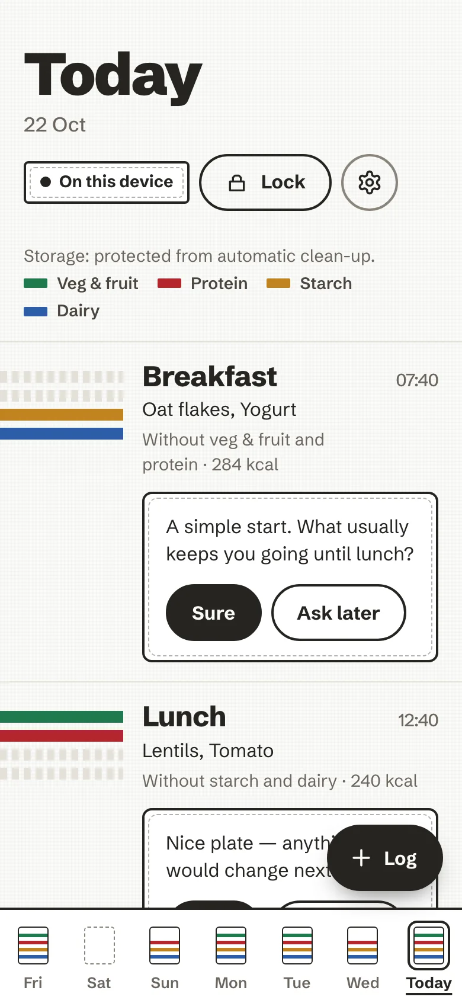
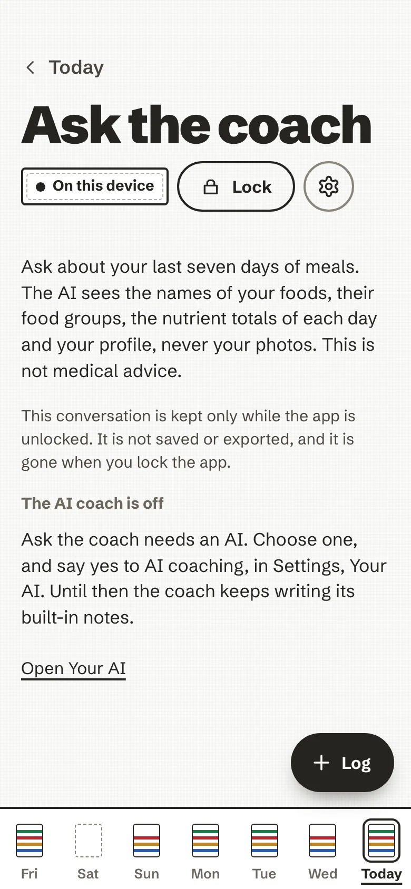

# The coach

The coach asks rather than tells. It reads your plates with you and, now and then, asks one question. It never
grades a meal, never keeps a tally of how you are doing, and saying "not now" costs nothing.

## One question under a plate

After you log a plate, the coach may ask one question underneath it, in a small sewn label:

> A simple start. What usually keeps you going until lunch?

Two answers are offered:

- **Sure** opens one short, practical follow-up ("Eggs, yogurt or a handful of nuts tend to last longer than bread
  or cereal alone, if you ever want a change."). That is all; it does not open a conversation.
- **Ask later** puts the question away for good. The coach never asks the same question again and never brings it
  back as a reminder.

<figure markdown>
{ .anc-phone loading=lazy }
<figcaption>One question, two calm answers.</figcaption>
</figure>

On today's board, the first meal still to come can carry a gentle hint too ("No veg or fruit logged yet today.
Could this meal have a handful?"). Tap it to dismiss it.

### Where the questions come from

The built-in questions are rules that run on the device, with no AI: they look at which groups are on the plate
and on the day so far, and, while nutrition numbers are shown, at a few amounts against the day's guide (for
example a plate with a lot of salt, or a day low on fibre). A question that quotes an amount always says it is
approximate ("~2.1 g of salt, around 35% of a day's guide"). With *Show nutrition numbers* turned off, the questions
that quote amounts are not asked.

The week has its own remarks, also worked out on the device: *What went well* and *One thing to try*, under
[This week](day-and-week.md#this-week).

## With an AI: notes, questions and the week

If you connect an AI (see [Your AI](your-ai.md)) **and** turn on *AI coaching* in **Settings → Your AI**, which is
off by default, the coach can do three more things:

- **AI coach notes**: after a plate, a note written by the AI takes the place of the built-in question, marked
  *Written by AI*. If no acceptable note arrives within a few seconds, the built-in one stays.
- **Ask the coach**: type a question about your last seven days of meals, up to 500 characters, for example "is my
  week varied enough?". A conversation holds six questions; then you can start a new one. It is kept only while the
  app is unlocked: it is not saved or exported, and it is gone when you lock the app.
- **The coach, on this week**: *Ask the coach about this week* writes a short paragraph under the week's review.

<figure markdown>
{ .anc-phone loading=lazy }
<figcaption>Ask the coach, with an AI you chose.</figcaption>
</figure>

What the AI receives for coaching: the names and food groups of your foods, their weights and nutrient totals, the
dates of the days involved (no times), the meal slot, how many plates, your profile if you filled it in, and what
you type in *Ask the coach* with the earlier answers of that conversation. Never your photos, never your
passphrase. With nutrition numbers turned off, weights and nutrients are left out. The full list is in
[AI tiers, in detail](../ai-tiers.md#coaching-ai-coach-notes-ask-the-coach-the-weekly-paragraph).

### Every AI text is checked first

Before the app shows anything an AI wrote, it checks it: no exclamation marks, no pressure vocabulary, no links, no
medical claims and no harmful advice. A text that fails is dropped, and the built-in note stays. In the language of
the app, too: an AI note written in another language is not shown.

## Not a doctor

The coach gives no diagnosis, treatment or medication advice. If a question you type in *Ask the coach* is about a
worry with food or your body, or a symptom, it is **answered on the device and never sent**: with a pointer to a
doctor or a pharmacist, to emergency numbers when it sounds urgent, or to a support line. A short line about
eating-disorder support, with a link to one organisation per language (Beat in English, the FFAB in French), sits
with the nutrient bars and on the Profile, Nutrition and Ask the coach screens.
