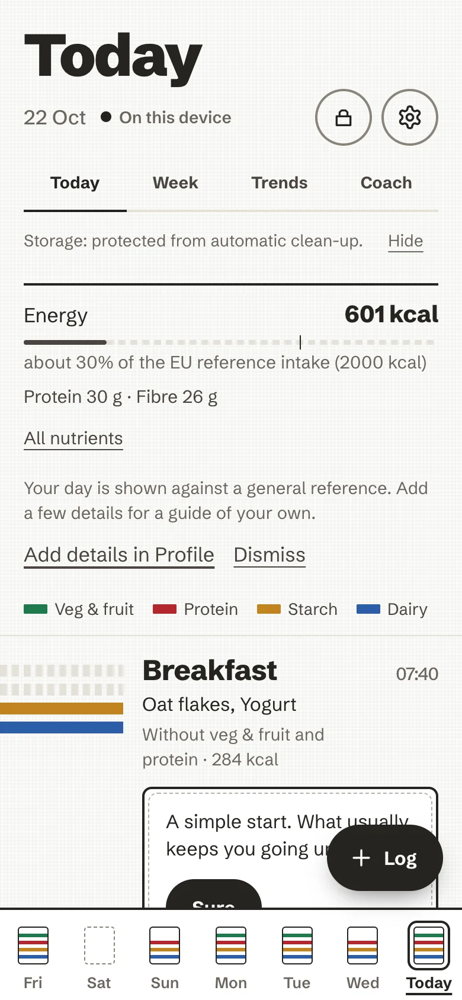
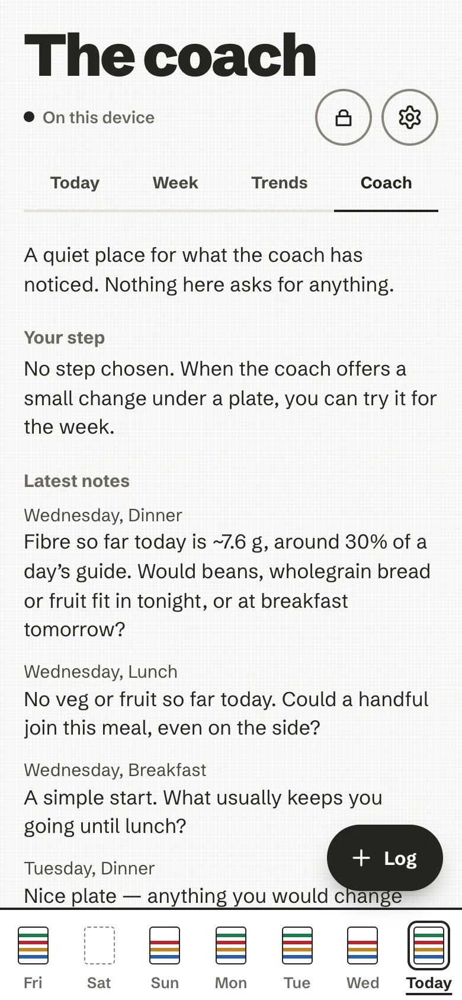

# The coach

The coach asks rather than tells. It reads your plates with you and, now and then, asks one question. It never
grades a meal, never keeps a tally of how you are doing, and saying "not now" costs nothing.

## One question under a plate

After you log a plate, the coach may ask one question underneath it, in a small sewn label:

> A simple start. What usually keeps you going until lunch?

Two answers are offered:

- **Sure** opens one short, practical follow-up ("A breakfast with some protein, like eggs, yogurt or nuts, tends to
  last longer, if you ever want a change."). That is all; it does not open a conversation.
- **Try it this week**, when the note suggests one small change, keeps it as your step (see below).
- **Ask later** puts the question away for good. The coach never asks the same question again and never brings it
  back as a reminder.

Every food a note names respects your **diet** and your **allergies** (*Settings → Profile*): a vegan never hears about
eggs, fish or cheese, and a tag such as "milk", "lactose", "lait", "gluten" or "fruits à coque" rules out that whole family
(and anything with the same word in its name). "APLV", "PLV" and "milk protein" count as milk. A peanut tag also rules out the mixed "nuts" suggestion, and a tree-nut tag rules out peanut too. A general legume tag ("pulses", "légumineuses") rules out lentils, chickpeas and beans, and also soy and peanut, which are legumes; a soy tag alone does not rule out lentils. A tag the coach does not know ("kiwi") still rules out any suggestion whose name contains it. If nothing suits, the note says "a protein you enjoy" rather than
naming a food. A note saved before foods were stored with it is shown the same food-free way.

<figure markdown>
{ .anc-phone loading=lazy }
<figcaption>One question, two calm answers.</figcaption>
</figure>

On today's board, the first meal still to come can carry a gentle hint too ("No veg or fruit logged yet today.
Could this meal have a handful?"). Tap it to dismiss it.

### Where the questions come from

The built-in questions are rules that run on the device, with no AI: they look at which groups are on the plate
and on the day so far, and, while nutrition numbers are shown, at a few amounts against the day's guide (for
example a plate with a lot of salt, or a day low on fibre). A question that quotes an amount always says it is
approximate ("~2.1 g of salt, around 35% of a day's guide"). With *Show nutrition numbers* turned off, the questions
that quote amounts are not asked.

### A coach that follows your goal

With **a daily guide of your own** (a profile with age range, sex and activity) the coach can compare your day with it,
and only from totals that are complete: a day with a food that has no weight, or whose energy is unknown, is never turned
into a remark. It does so **at dinner, or after a dinner, or late at night (21:00 to 04:59)**: a 17:30 snack is not the end of the day. Never mid-morning, and never while
you are pregnant or breastfeeding or a safeguard holds your guide at what keeps your weight steady.

- **Well above the guide** (about 115 % or more with the goal to lose weight, 130 % or more with any other goal): one note
  naming the one or two foods that carried most of the energy, and a question. *"Much of today's energy came from the
  pizza and the soda, about 1100 kcal together. Would a smaller portion of one of them suit you next time?"*
- **Close to the guide**: no remark about energy at all.
- **Well below it** (about 70 % or less at the end of the day, with at least three plates, goal to lose; 80 % for the goal
  to gain): one gentle line that eating enough matters, and a question about what may not have been logged. Never praise for
  eating little.
- **With the goal to lose weight**, one satiety suggestion at a time: a sugary drink (a drink with 5 g of sugars or more per
  100 ml) or an alcoholic one, protein on a plate that has none, vegetables on a plate that has none. The last two name a food
  **you actually log often**, not a generic list.

Nothing of this uses a streak, a score or a "remaining" figure, and with numbers turned off the lines that carry a figure are
worded without one (or are not said).

### One next step, remembered

A note that suggests one small change offers **Try it this week**: *a portion of vegetables at lunch*, *water instead of
sugary drinks*, *a smaller portion of the pizza*. You can have **one** step at a time. It shows quietly on **Today**
("This week: a portion of vegetables at lunch") with **Done with this** and **Drop it**; both simply remove it. There is no count,
no streak and no ticking off of days. The week's review looks back at it from what you logged and says so plainly ("You chose
vegetables at lunch. They were on four of the six lunches logged.") and offers to keep it another week, change it or drop it.
A step the log cannot show (a smaller portion) is not checked. It works fully without an AI; it is kept with your other
preferences, so it syncs, goes into the JSON export and is erased with everything else.

### The coach page

*Ask the coach* on Today opens **The coach**, a page that is useful with or without an AI: your step, the latest notes of the
last days, the week in short, your daily guide with a link to Profile and, only when an AI is available and you said yes, the
conversation below. Without an AI it says so in one line, with the link to *Your AI*; nothing on the page is greyed out.

### The week

The week has its own remarks, also worked out on the device, under [This week](day-and-week.md#this-week): *What went well*,
*One thing to try*, and, with a guide of your own, a neutral energy line ("On the five days counted, energy averaged about 2,150 kcal,
a little above your guide of 1,900 kcal.") with the energy-dense foods that came up on several days. Only days that look like whole days count toward that line: complete, and with at least three plates or a dinner, so partial logging never reads as "well below". With the goal to lose or gain
weight and weigh-ins, it relates the weight trend to the logged energy, descriptively and never as a verdict ("Your weight trend is
about 0.3 kg lower than four weeks ago, while your logged energy averaged close to your guide."). If the two disagree (logging well
under the guide while the trend is flat) it says calmly that logged amounts are estimates and that uncounted foods or portions are
the usual reason.

At most one **neutral remark about the food itself**, in the spirit of France's public-health guidance, from what the food names can
support reliably: pulses on fewer than two days, fish about twice a week (skipped for vegetarian, vegan and a fish allergy), wholegrain
versions of bread, pasta and rice, a small handful of unsalted nuts (skipped on a nut allergy; a nut butter such as peanut butter does not count as that handful), cured meat or red meat on four or more
days, sugary drinks. Each comes with an optional step. They need a week with at least five days logged.

## With an AI: notes, questions and the week

If you connect an AI (see [Your AI](your-ai.md)) **and** turn on *AI coaching* in **Settings → Your AI**, which is
off by default, the coach can do three more things:

- **AI coach notes**: after a plate, a note written by the AI takes the place of the built-in question, marked
  *Written by AI*. If no acceptable note arrives within a few seconds, the built-in one stays.
- **Ask the coach**: type a question about your last seven days of meals, up to 500 characters, for example "is my
  week varied enough?" or, with the goal to lose weight, "how do I lose weight with what I eat?". A conversation holds six questions; then you can start a new one. It is kept only while the
  app is unlocked: it is not saved or exported, and it is gone when you lock the app.
- **The coach, on this week**: *Ask the coach about this week* writes a short paragraph under the week's review.

<figure markdown>
{ .anc-phone loading=lazy }
<figcaption>Ask the coach, with an AI you chose.</figcaption>
</figure>

What the AI receives for coaching: the names and food groups of your foods, their weights and nutrient totals, the
dates of the days involved (no times), the meal slot, how many plates, your profile if you filled it in, your daily guide
(rounded), the week's average energy next to that rounded guide, the foods that carried the most energy, the step you chose, and what
you type in *Ask the coach* with the earlier answers of that conversation. Never your photos, never your
passphrase, never your weight, height or waist. With nutrition numbers turned off, weights, nutrients and energy figures are left
out. A coarse **weight trend** (a direction and the change over about four weeks, to the nearest half kilo) is sent only if you turn
on the separate, off-by-default switch *Share my weight trend with the coach* in *Settings → Your AI*. The full list is in
[AI tiers, in detail](../ai-tiers.md#coaching-ai-coach-notes-ask-the-coach-the-weekly-paragraph).

### Help with weight, within limits

If your goal in Profile is to **lose weight** (or gain), the coach may help with it: energy balance explained plainly, your daily
guide and the foods you log, specific swaps and portions, feeling full (protein, fibre, vegetables, drinks, regular meals), a
realistic pace (about 0.25 to 0.75 kg a week at first) and the fact that plateaus and day-to-day changes on the scale are normal.
It never suggests eating below your guide or below the floor, never fasting, skipping meals, meal replacements, supplements, "detox"
or exercise to make up for a meal, never comments on your body, and points to a doctor or a dietitian for a medical condition,
pregnancy, medication, being under 18, or a wish to lose more or faster. With any other goal it does not bring weight loss up.
A question asking for a very low intake or a very fast loss is answered on the device, with a calm line, and never sent.

### Every AI text is checked first

Before the app shows anything an AI wrote, it checks it: no exclamation marks, no pressure vocabulary, no links, no
medical claims, no comment on your body and no harmful advice (fasting, skipping meals, a daily figure below your floor, a loss
faster than a kilo a week, and the like). A text that fails is dropped, and the built-in note stays. In the language of
the app, too: an AI note written in another language is not shown.

## Not a doctor

The coach gives no diagnosis, treatment or medication advice. If a question you type in *Ask the coach* is about a
worry with food or your body, or a symptom, it is **answered on the device and never sent**: with a pointer to a
doctor or a pharmacist, to emergency numbers when it sounds urgent, or to a support line. A short line about
eating-disorder support, with a link to one organisation per language (Beat in English, the FFAB in French), sits
with the nutrient bars and on the Profile, Nutrition and Ask the coach screens.
