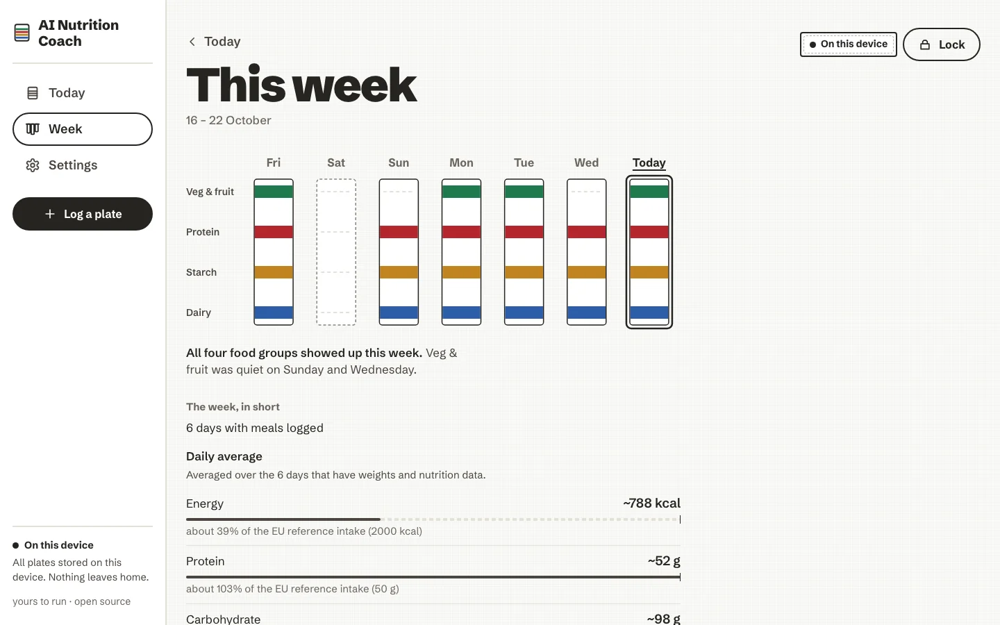
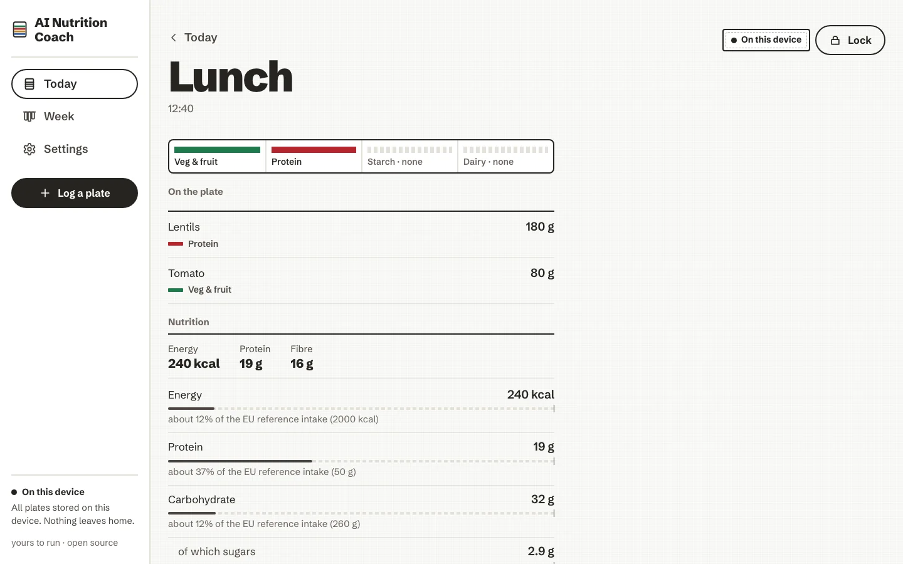

# Your day and your week

The app has two places to look back: **Today**, the Day Board, and **This week**. Both show balance as woven
stripes first, and the numbers one tap away.

<!-- anc-video:day-and-week -->

  
  

    
In video

    
<a href="/ai-nutrition-coach/video/day-and-week/">The day and the week</a>

    
The Day Board, a plate's nutrients, and seven towels side by side.

  

<!-- /anc-video -->

## The four groups

Every food belongs to one group, and every group has one dye, always shown beside its name:

<ul class="anc-legend">
  <li class="veg">Veg and fruit</li>
  <li class="protein">Protein</li>
  <li class="starch">Starch</li>
  <li class="dairy">Dairy</li>
</ul>

A group that is not on a plate is drawn as bare cotton, a dashed line, never as a warning colour. Foods outside the
four groups count as *other*, which has no dye. The red is protein, and only protein: nothing in the app is ever
"in the red".

## Today, the Day Board

The day is a stack of bands, one per plate. Each band carries the stripes of the groups on the plate, and beside it
the meal's name and time, the foods, the groups that are not there ("Without dairy"), and an approximate energy
figure. A meal that is still to come is an open band with a dashed edge: *Nothing logged yet.*

<figure markdown>
{ loading=lazy }
<figcaption>Today on a phone. The dock at the bottom holds the week, folded.</figcaption>
</figure>
<figure markdown>
{ loading=lazy }
<figcaption>A plate's page: foods, grams and nutrients.</figcaption>
</figure>

- On a **phone**, the dock at the bottom holds the week as seven folded towels: small stripes for the groups logged
  each day, a dashed edge for a day with nothing logged. Tap one to see that day. The floating **Log** pill sits
  above it.
- On a **computer**, a rail on the left holds Today, Week, Settings and *Log a plate*, and *This week at a glance*
  sits beside the day.
- Under the bands, **Today's nutrition** adds up the day.
- A small label says where your plates are: *On this device*. Once per session, a plain line also says whether the
  browser has agreed to keep your data safe from automatic clean-up; if it has not, it suggests a regular backup.

<figure class="anc-wide" markdown>
{ .anc-desktop loading=lazy }
<figcaption>On a computer, the rail and the week at a glance sit beside the day.</figcaption>
</figure>

## A plate's page

Tap a band to open its plate:

- the groups it carries, by name;
- each food with its portion and weight. A weight you typed is shown as it is; a weight that is a guess, from a
  preset or a photo, is marked ≈;
- the plate's nutrition (below);
- *Save as a meal*, *Log this again*, and *Remove this plate*. Removing asks once, calmly, and takes the plate's
  coach note with it.

## Nutrients, against the EU reference intakes

For each plate, each day and, on the week, each daily average, the app shows the nutrients it has data for:
**energy, protein, carbohydrate (of which sugars), fat (of which saturates), fibre and salt**. Each is one row:

- the value and its unit, as text;
- a neutral bar, the same soft ink for every nutrient and every amount, with a small tick at the reference;
- a sentence naming the reference: "about 24% of the EU reference intake (2000 kcal)".

The references are the daily amounts in EU Regulation 1169/2011 for an average adult eating 2,000 kcal a day; fibre
has no EU value, so 25 g, a general recommendation, is used. *What are reference intakes?* under the bars says this
in the app. If you fill in your [profile](settings.md#profile), the bars use **your daily guide** instead, worked out
from European (EFSA) reference values for your age range, sex and activity. Either way it is information, not a
target.

How the numbers are kept honest:

- **Estimates carry "~"**. A value worked out from a guessed weight is never shown as exact.
- **Unknown is left empty, never shown as zero.** When some foods have no weight or no nutrition data, a sentence
  says what the total is based on ("Based on 3 foods with a weight and nutrition data; 1 without.").
- **Past the reference, it says so in plain words** ("about 120% of the reference"). Nothing turns red, nothing says
  "over budget", "remaining" or "exceeded", and the bars never change colour.
- No rings, no gauges, no grades, no score of you. Open Food Facts' Nutri-Score and NOVA can appear on a packaged
  product, attributed, as information about that product.

The design record behind this is [ADR 0006: Real nutrition numbers, calm framing](../adr/0006-nutrition-numbers-calm-framing.md).

### Hiding the numbers

If numbers about food feel stressful, turn off *Show nutrition numbers* in **Settings → Nutrition**. The values and
bars are hidden; your meals and their weights stay. The coach's built-in questions that quote an amount are left
out, and an AI coach is told not to quote amounts.

## This week

Seven towels hang side by side under the weekday names, with the group names down the left. Each towel shows a
dyed stripe for every group that appeared that day and a dashed line for the rest; today's towel is outlined in
ink. A plain sentence underneath says which groups showed up, and which stayed quiet ("Dairy was quiet on Tuesday
and Friday.").

<figure markdown>
{ loading=lazy }
<figcaption>The week as seven towels, then day by day.</figcaption>
</figure>

Below the towels:

- **Day by day**, under a 2px ink rule: each day's name, four small stripe segments (dashed when a group is
  absent) and its number of plates. Tap a day to open its board.
- **The week, in short**: how many days have meals logged, the **daily average** of each nutrient over the days that
  have weights and nutrition data, *What went well* and *One thing to try*. These remarks are rules worked out on
  the device; they need no AI.
- With an AI and AI coaching turned on, **Ask the coach about this week** writes a short paragraph about it. See
  [The coach](coach.md).

A line on the page says it plainly: no streaks, no countdowns, no guilt.

<figure class="anc-wide" markdown>
{ .anc-desktop loading=lazy }
<figcaption>This week on a computer.</figcaption>
</figure>

<figure class="anc-wide" markdown>
{ .anc-desktop loading=lazy }
<figcaption>A plate's page on a computer.</figcaption>
</figure>
