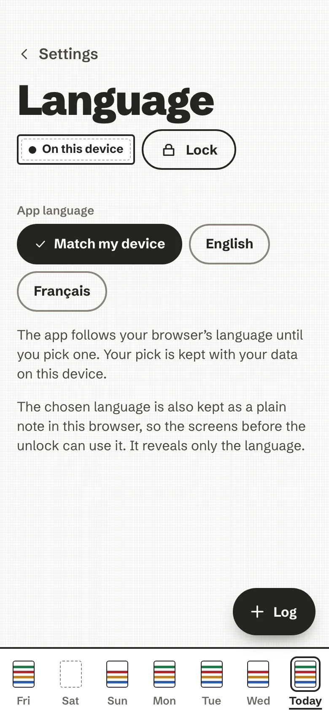

# Languages

The app speaks **English** and **French**.

<figure markdown>
{ .anc-phone loading=lazy }
<figcaption>Settings, Language.</figcaption>
</figure>

- Until you choose, it **follows your browser's languages** (*Match my device*): the first one it speaks wins, so a
  browser set to German, then French, gets French. Otherwise it is English.
- **Settings → Language** fixes the choice. It is kept with your data, encrypted, and also as a plain note in the
  browser, so the screens before the unlock can use it. That note reveals only the language.
- Food names, units, dates and the coach's questions all follow the app's language.
- **AI texts follow it too.** The fixed instruction sent with a photo, a description or a coaching request asks the
  AI to answer in the app's language. A coach note an AI wrote in the other language is not shown after you switch.
- The eating-disorder support line links to one organisation per language: Beat in English, the FFAB in French.

## Adding a language

Every sentence of the interface lives in one typed catalogue per language, so no screen changes: a new language is
that catalogue, its food names and food-group keywords, the fixed AI instructions and a few tests. The steps are in
[CONTRIBUTING.md](https://github.com/mmornati/ai-nutrition-coach/blob/main/CONTRIBUTING.md#adding-a-language).
Careful translations are very welcome.
