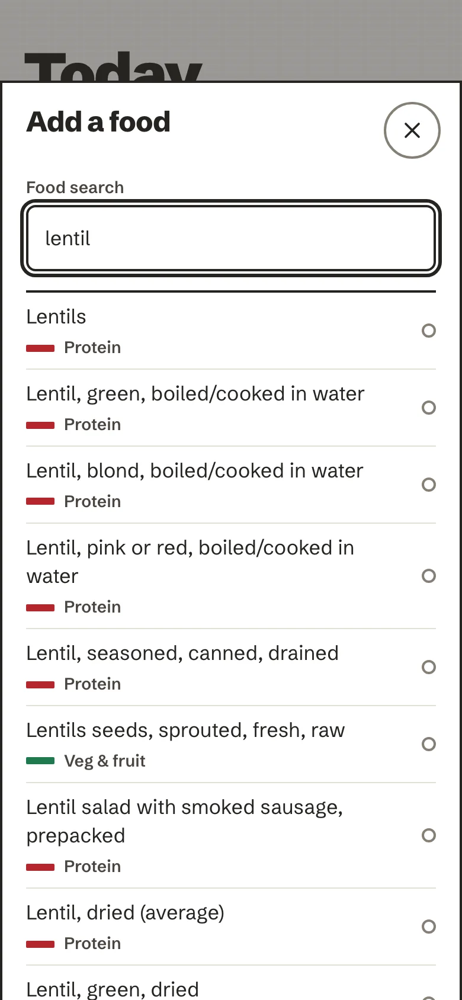
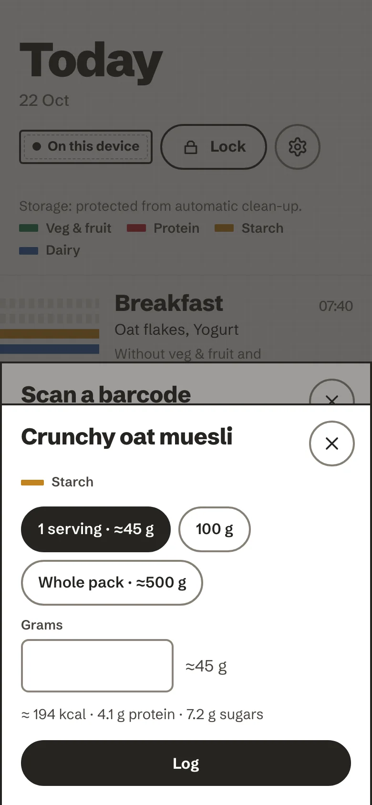
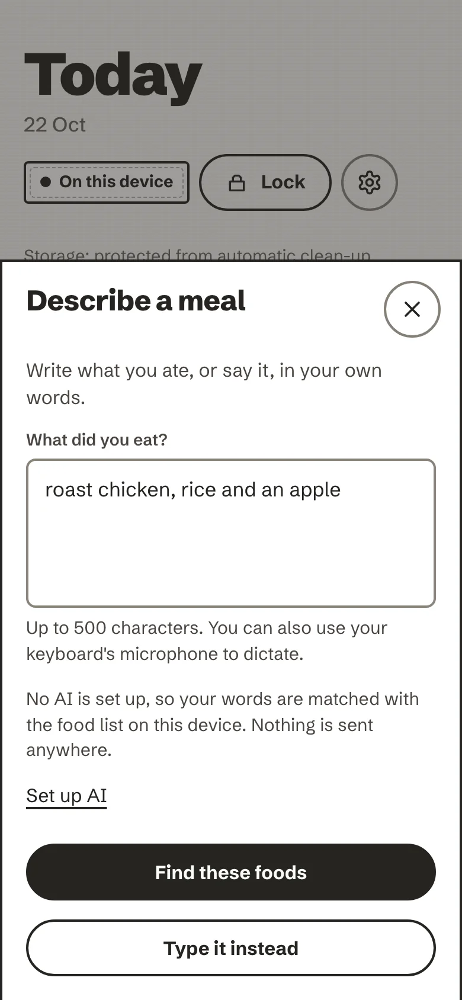
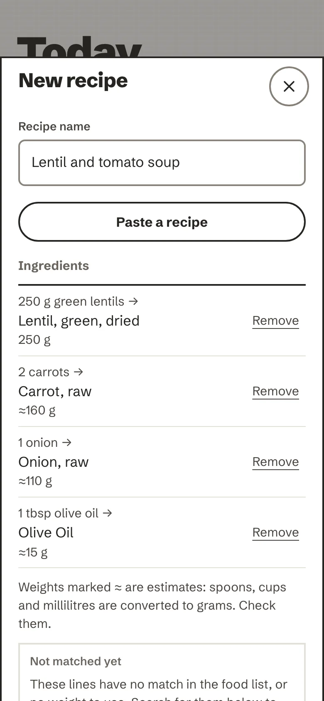
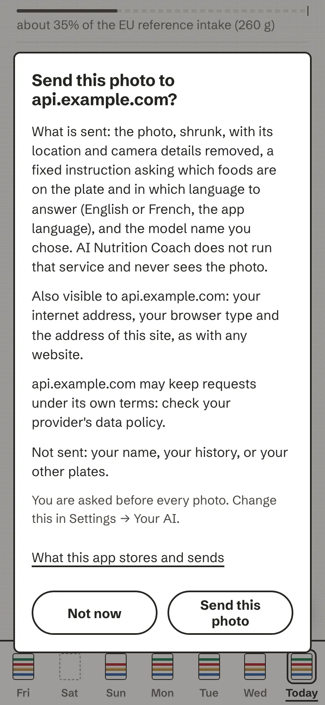

# Log a plate

Press **Log** (the ink pill at the bottom right on a phone, *Log a plate* in the rail on a computer). One sheet
opens with every way in. Whichever you pick, you see the foods and amounts before anything is saved, and the meal
always lands: offline, without an AI, or with a barcode nobody knows, you still get the closest matches and a
quantity to adjust.

<!-- anc-video:log-a-plate -->

  
  

    
In video

    
<a href="/ai-nutrition-coach/video/log-a-plate/">Log a plate</a>

    
Every way in, and the one review before anything is saved.

  

<!-- /anc-video -->

<figure markdown>
{ loading=lazy }
<figcaption>The sheet names the next meal and offers four ways in.</figcaption>
</figure>
<figure markdown>
{ loading=lazy }
<figcaption>Type it works offline, from the food list on the device.</figcaption>
</figure>

The sheet says which meal comes next (*Next meal: Lunch*). Meals are breakfast, lunch, dinner and late; a plate
lands in the meal you choose.

## Type it

Start typing a food name and the matches are ranked as you go, from the food list built into the app: a short list
of everyday foods and the CIQUAL table, about 3,500 generic foods with their nutrition per 100 g (ANSES, Etalab
Open Licence 2.0). It all runs on the device, so it works without a connection.

Pick a match, then a portion: a preset (small portion, one portion, large portion, 100 g, one serving, a whole
pack, depending on the food) or a weight in grams, from 0.1 to 5,000 g. A one-line preview under the grams field
shows the approximate energy, protein and sugars of that amount. A food that is not in the list can be logged as a
custom food under its own name.

## Barcode

For packaged food. The camera reads the code **on the device**, with a pinned WebAssembly decoder; no image ever
leaves it. Hold the pack about 20 cm away and fit the barcode in the box. There is a torch button where the phone
has one, and *Type the barcode* if the code will not scan (a barcode has 8, 12 or 13 digits; the app checks that
they add up).

The product is then looked up on **Open Food Facts**, a free, open database with no account. Only the barcode is
sent, with a request for the fields the app needs. The first time, a short notice explains this and lets you choose
*Don't look up online*; you can change it later on the privacy page.

<figure markdown>
{ .anc-phone loading=lazy }
<figcaption>A product found on Open Food Facts, ready for a portion.</figcaption>
</figure>

If the product is not there, the app says so and offers to type it in, with a link to add the product to Open Food
Facts yourself; the app itself posts nothing. If the camera is refused or the browser cannot read barcodes, the
sheet says so calmly and *Type it* is one tap away.

## Describe it, in words or out loud

Write what you ate in your own words: "two eggs, toast with butter, a coffee with milk" (up to 500 characters).
Your keyboard's own microphone can dictate it too.

- **Without an AI**, your words are matched with the food list on the device, and nothing is sent anywhere.
- **With an AI** and your yes to *Describe*, the words go to the AI you chose to be understood, and come back as the
  same reviewable list a photo gives: every food ticked, amounts to check, and any words that did not match listed
  so you can add them by hand.
- **Talk**: with an AI whose service can turn voice into text, a *Talk* button records up to 30 seconds. The
  recording is turned into text, shown to you to check, and never stored by the app.

The first time something would be sent, a card asks first and says exactly what goes, to whom: *Allow* or *Not
now*. Saying no costs nothing; the words are matched on the device instead.

<figure markdown>
{ .anc-phone loading=lazy }
<figcaption>Describe: write it, dictate it, or say it.</figcaption>
</figure>

## Paste a recipe

Paste the ingredients, or the whole text of a recipe page, up to 8,000 characters. **Nothing is fetched from the
web**: a pasted address is just text. The app reads amounts, units and servings, matches each ingredient to the food
list and fills in a recipe for you to check. Spoons, cups and millilitres are converted to grams and marked ≈, as
estimates. Lines it could not match are listed under *Not matched yet*, with suggestions (*Did you mean one of
these?*), so you can add them by hand.

With an AI and your yes to *Describe*, the recipe text can be read by the AI instead; if it is busy or declines,
the text is read on the device.

<figure markdown>
{ .anc-phone loading=lazy }
<figcaption>A pasted recipe, matched and ready to check.</figcaption>
</figure>

## Snapshot: one photo

With an AI connected, take or choose one photo of the plate. The AI suggests the foods, their weights and their
groups; a confident match in the food list replaces the AI's own nutrient guess. Everything comes back ticked, with
*likely* or *maybe* beside it: untick anything that is not on the plate, adjust the amounts, then log.

Before a photo leaves the device, it is shrunk and its location and camera details are removed. By default **you
are asked before every photo**, with the name of the service it would go to. The photo is kept in memory only.

<figure markdown>
{ .anc-phone loading=lazy }
<figcaption>Every photo asks first, unless you turn that off in Your AI.</figcaption>
</figure>

Without an AI, *Snapshot* says that photo recognition needs one, and offers your recent foods and *Type it*
instead. Setting one up is described in [Your AI](your-ai.md).

## Recent and frequent foods

Under the four ways in, the sheet lists your **recent** foods and the ones you log **often** (with how many times
in the last 30 days). One tap logs a food at its usual amount; *Change* adjusts it first.

## Saved meals and recipes

- **Save as a meal**: on a plate's page, keep its foods and amounts under a name, to log them again in a tap.
- **New recipe**: write a home recipe with its ingredients in grams, the number of servings and, if you weighed it,
  the cooked weight of the finished dish (it gives a closer result). The app works out the values per serving from
  the ingredients. When nutrition data is known for only some ingredients, it says so, rather than counting the rest
  as zero.
- **Saved meals and recipes** in the Log sheet lists both. Log a meal as it is or change an amount first; rename or
  delete either. Deleting a saved meal leaves the plates you already logged from it as they are.

## Log it again, or copy a day

- **Log this again**, on any plate's page: a new plate with the same foods and amounts, on today or one of the six
  days before it, in the meal you choose. The original stays as it is.
- **Copy this day to today**, when you look at an earlier day: its plates are added to today at the same times.
  What is already on today stays, and a plate whose time is still ahead is not copied.
- Just after you log, a quiet *+ log another plate* link appears for a few seconds, for the second plate of a meal.

## If something does not save

The app says so in a plain sentence ("That did not save just now. Nothing was lost; you can try again.") and keeps
what you entered. It never shows a spinner: a button that is working says what it is doing (*Logging…*).
