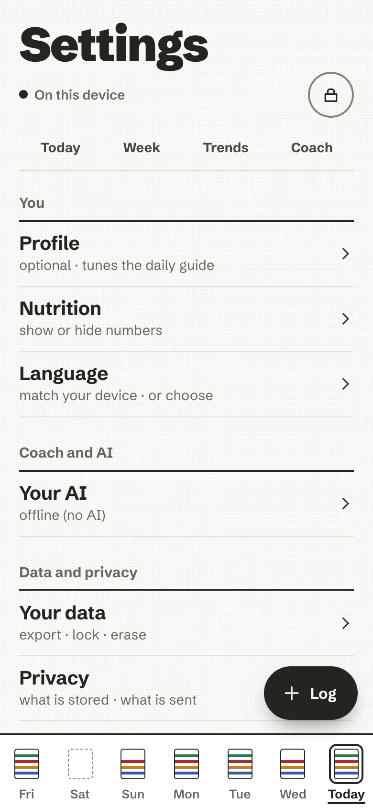
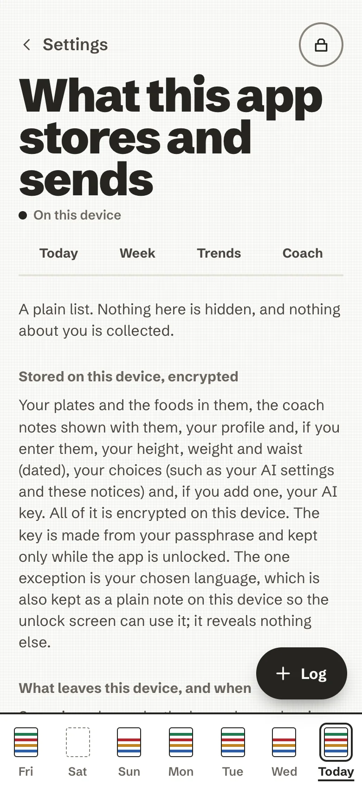
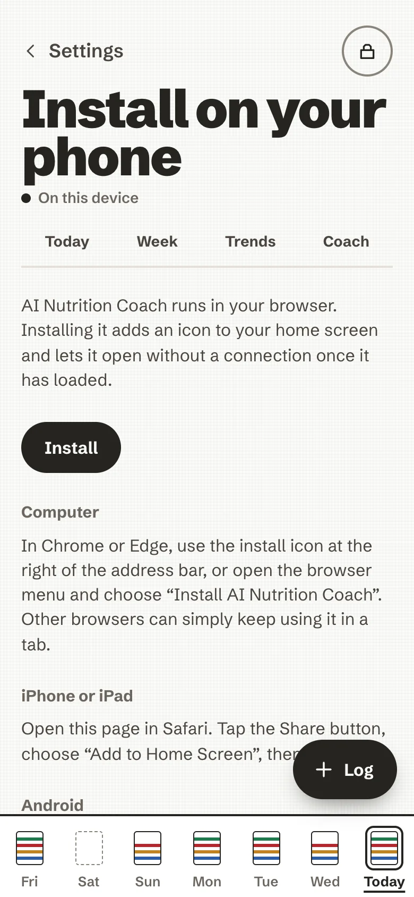

# Settings

**Settings** (in the rail on a computer, from the gear on a phone) is a short list. Each row says what it holds in a
few words.

<figure markdown>
{ loading=lazy }
<figcaption>The Settings list.</figcaption>
</figure>
<figure markdown>
{ loading=lazy }
<figcaption>Privacy: what is stored, what is sent.</figcaption>
</figure>

| Row | What it holds |
| --- | --- |
| **Your AI** | No AI, this server's AI or your own key, and a switch for each use. See [Your AI](your-ai.md). |
| **Your data** | Lock, export, encrypted backup, restore and erase. See [Back up, export, erase](your-data.md). |
| **Privacy** | What is stored, what is sent, and to whom. |
| **Nutrition** | Show or hide the nutrition numbers, and, if you like, the distance to your daily guide. |
| **Profile** | Optional; it tunes your daily guide and the coach. |
| **Language** | Match your device, or choose. See [Languages](languages.md). |
| **Install on your phone** | How to add the app to your home screen. |
| **Saved meals** | Your saved meals and recipes: rename or delete them. |
| **About** | The project, and the open-source licences of what it is built with. |

## Profile

Optional, and empty until you fill it in. It tunes your daily guide, the reference the nutrient bars are drawn
against, and what the coach takes into account. It stays encrypted on the device and travels with your encrypted
backup or sync. It is in five parts.

- **About you**: age range, sex (female, male, or prefer not to say), and activity (mostly seated, some movement,
  active, very active). If your goal is to lose weight and your sex is not male, a checkbox says you are pregnant or
  breastfeeding; the guide does not account for the extra needs of pregnancy or breastfeeding, and a midwife or a doctor
  is the right person to ask.
- **Body**: height, and dated weigh-ins for weight and waist, all optional, in metric or imperial units. One
  entry per day for each; a second the same day replaces the first. BMI and the waist-to-height ratio can be shown
  as plain numbers, behind a disclosure, next to the reference ranges for adults written as text, with the caveats
  (a muscular build, 65 and over, pregnancy, and lower ranges for some backgrounds). They are never a label on you
  and never coloured. Your weight, height, waist and BMI themselves are not sent to an AI; the coach receives your daily
  guide, rounded, which is worked out from your weight and height if you entered them.
- **Goal**: eat better, stay as I am, lose weight, or gain weight, with a pace (gentle, standard, faster) for the
  last two. Your daily guide is the energy that keeps your weight steady, moved by a modest amount for the goal. In
  some cases it stays at maintenance and a calm line points to a doctor or a dietitian: a low BMI with the goal to
  lose weight, a guide that could only be reached below 1,500 kcal (1,200 for a woman), pregnancy or breastfeeding,
  or age 65 and over with a BMI below 30. A weight-loss or weight-gain guide needs your height and weight (to know
  the BMI): without them it stays at maintenance and asks for them. Those floors and the usual "5 to 10 % in six
  months" are conventions from clinical practice, not thresholds. You can also set your own energy figure; one below
  the floor is refused with an explanation, and so is one below maintenance while one of those safeguards holds the
  guide there.
- **Your daily guide**: what it comes to ("Your daily guide is about 2100 kcal."), how it was worked out (Henry 2005
  and EFSA 2013 for energy, EFSA and ANSES for protein), and that it is an estimate, usually within about 10 %.
  Without enough in the profile, the EU reference intake of 2,000 kcal is used.
- **Food**: diet (everything, vegetarian, vegan, or fish and no meat) and allergies or foods to avoid, one tag at a
  time.

The goal and pace choice and the Body section (once, for weight, height and waist) carry one calm line: if food or
weight worries take up a lot of your thoughts, talking to someone can help. With nutrition numbers turned off, the
daily guide part shows no figures, only the calm notices and a link to *Settings → Nutrition*.

There is no field for a name or a birth date. *Clear profile* empties the answers. *Remove all measurements* is a
separate button: it asks first, and removes every weigh-in and waist measurement on every device that syncs. The
weigh-in and waist fields start empty, with the last one shown as text beside them. A weigh-in for another day, the
history, the trend and the chart are in [Trends](progress.md); the guide always uses your latest weigh-in, and *How
this is worked out* says which one and when it was taken (a quiet line suggests an update after 60 days). If the
weight trend falls faster than about 1 % a week for a while, one calm line points to a gentler pace or to a doctor or
a dietitian.

The first-run welcome asks the same questions as *About you*, *Body* (height and weight), *Goal* and *Pace*, and
writes them to the same place.

## Nutrition

- **Show nutrition numbers.** If numbers about food feel stressful, turn it off. Nutrient values and bars are hidden,
  the coach stops quoting amounts, and an AI coach is sent no weights or nutrients. Your meals and their weights stay,
  and turning it back on brings everything back.
- **Show the distance to my daily guide.** Off by default. When on, one plain line says how far you are from your daily
  guide, for example "about 450 kcal to your daily guide", and once past it "about 120 kcal past your daily guide".
  No colour, no icon, no ring. Without it, going past the guide is only said as a plain percentage ("about 112 % of
  your daily guide").

## Privacy

*What this app stores and sends*, as a plain list, in the app itself:

- what is **stored on this device**, encrypted (and the one exception: your chosen language, kept as a plain note so
  the unlock screen can use it);
- what **leaves the device, and when**: a barcode to Open Food Facts, a photo, your words or your meals to the AI
  you chose, each only after your yes;
- what **the server you got the app from** sees: nothing about you or your plates;
- what is **never collected**: no analytics, no tracking, no crash reports, no advertising, no accounts;
- how to delete one plate or everything, how exports and backups work, and what a shared device means.

It also holds the switch **Look up barcodes on Open Food Facts**. Off, only the offline food list is used and an
unknown barcode opens manual entry.

## Install on your phone

The app runs in your browser; installing it adds an icon to your home screen, opens it without the browser bars, and
lets it open without a connection once it has loaded.

<figure markdown>
{ .anc-phone loading=lazy }
<figcaption>The install steps, in the app.</figcaption>
</figure>

- **iPhone or iPad**: open the page in Safari, tap *Share*, choose *Add to Home Screen*, then *Add*.
- **Android**: in Chrome, open the menu (⋮) and choose *Install app* (or *Add to Home screen*). The page may also
  offer an *Install* button.
- **Computer**: in Chrome or Edge, the install icon at the right of the address bar, or *Install AI Nutrition
  Coach* in the browser menu. Other browsers can keep using it in a tab.

On iPhone, Safari may clear a website's data if you have not visited it for a while; an app added to the Home Screen
is not subject to that, and it keeps its own separate data. So install it **before** you start logging.

When a new version is ready, a calm line says so: *Reload* or *Later*. Reloading locks the app, so you enter your
passphrase again. More in [The installable app](../pwa.md).

## Saved meals

The meals you saved from a plate and the recipes you wrote, in two lists. Rename or delete either; deleting one leaves
the plates you already logged from it as they are. Logging them is described in
[Log a plate](log-a-plate.md#saved-meals-and-recipes).

## About

The project's line, *yours to run · open source*, and the licences: the app (MIT), the Schibsted Grotesk typeface
(SIL Open Font License 1.1), SQLite3 Multiple Ciphers, zxing-wasm and zxing-cpp, React, and the CIQUAL food
composition table (Etalab Open Licence 2.0).
