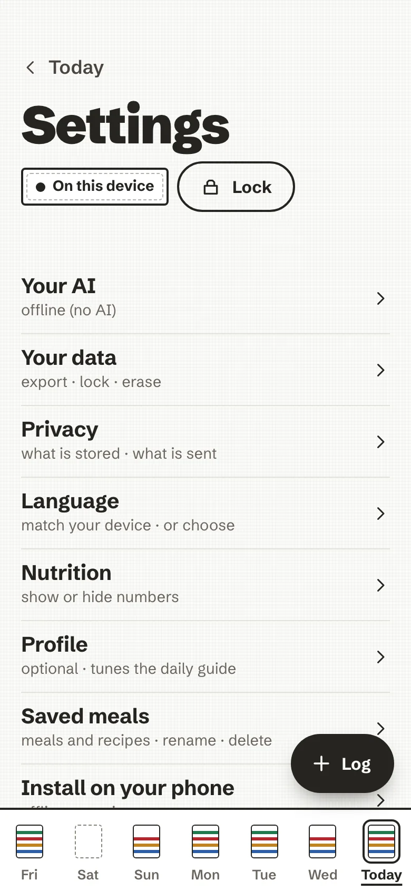
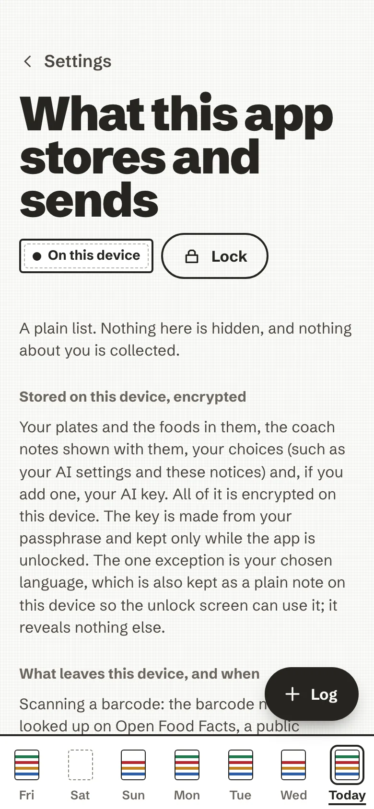

# Settings

**Settings** (in the rail on a computer, from the gear on a phone) is a short list. Each row says what it holds in a
few words.

<figure markdown>
{ loading=lazy }
<figcaption>The Settings list.</figcaption>
</figure>
<figure markdown>
{ loading=lazy }
<figcaption>Privacy: what is stored, what is sent.</figcaption>
</figure>

| Row | What it holds |
| --- | --- |
| **Your AI** | No AI, this server's AI or your own key, and a switch for each use. See [Your AI](your-ai.md). |
| **Your data** | Lock, export, encrypted backup, restore and erase. See [Back up, export, erase](your-data.md). |
| **Privacy** | What is stored, what is sent, and to whom. |
| **Nutrition** | Show or hide the nutrition numbers. |
| **Profile** | Optional; it tunes the daily guide and the coach. |
| **Language** | Match your device, or choose. See [Languages](languages.md). |
| **Install on your phone** | How to add the app to your home screen. |
| **Saved meals** | Your saved meals and recipes: rename or delete them. |
| **About** | The project, and the open-source licences of what it is built with. |

## Profile

Optional, and empty until you fill it in. It only tunes the daily guide the nutrient bars are drawn against, and
what the coach takes into account. It stays encrypted on the device.

- **Age range**, **sex** (female, male, or prefer not to say) and **activity** (mostly seated, some movement, very
  active). With all three set, the screen says what your daily guide comes to (for example "Your daily guide is about
  2100 kcal."), worked out from European (EFSA) reference values. Until then, the EU reference intake of 2,000 kcal is
  used.
- **Goal**: eat better, stay as I am, lose a little weight, or gain a little weight. A goal only moves the energy
  guide by 10 %, and never below 1,500 kcal.
- **Diet**: everything, vegetarian, vegan, or fish and no meat.
- **Allergies or foods to avoid**, one tag at a time.

There is no field for a name, a birth date, a weight or a height. *Clear profile* empties it in one tap.

## Nutrition

One switch: **Show nutrition numbers**. If numbers about food feel stressful, turn it off. Nutrient values and bars
are hidden, the coach stops quoting amounts, and an AI coach is sent no weights or nutrients. Your meals and their
weights stay, and turning it back on brings everything back.

## Privacy

*What this app stores and sends*, as a plain list, in the app itself:

- what is **stored on this device**, encrypted (and the one exception: your chosen language, kept as a plain note so
  the unlock screen can use it);
- what **leaves the device, and when**: a barcode to Open Food Facts, a photo, your words or your meals to the AI
  you chose, each only after your yes;
- what **the server you got the app from** sees: nothing about you or your plates;
- what is **never collected**: no analytics, no tracking, no crash reports, no advertising, no accounts;
- how to delete one plate or everything, how exports and backups work, and what a shared device means.

It also holds the switch **Look up barcodes on Open Food Facts**. Off, only the offline food list is used and an
unknown barcode opens manual entry.

## Install on your phone

The app runs in your browser; installing it adds an icon to your home screen, opens it without the browser bars, and
lets it open without a connection once it has loaded.

<figure markdown>
{ .anc-phone loading=lazy }
<figcaption>The install steps, in the app.</figcaption>
</figure>

- **iPhone or iPad**: open the page in Safari, tap *Share*, choose *Add to Home Screen*, then *Add*.
- **Android**: in Chrome, open the menu (⋮) and choose *Install app* (or *Add to Home screen*). The page may also
  offer an *Install* button.
- **Computer**: in Chrome or Edge, the install icon at the right of the address bar, or *Install AI Nutrition
  Coach* in the browser menu. Other browsers can keep using it in a tab.

On iPhone, Safari may clear a website's data if you have not visited it for a while; an app added to the Home Screen
is not subject to that, and it keeps its own separate data. So install it **before** you start logging.

When a new version is ready, a calm line says so: *Reload* or *Later*. Reloading locks the app, so you enter your
passphrase again. More in [The installable app](../pwa.md).

## Saved meals

The meals you saved from a plate and the recipes you wrote, in two lists. Rename or delete either; deleting one leaves
the plates you already logged from it as they are. Logging them is described in
[Log a plate](log-a-plate.md#saved-meals-and-recipes).

## About

The project's line, *yours to run · open source*, and the licences: the app (MIT), the Schibsted Grotesk typeface
(SIL Open Font License 1.1), SQLite3 Multiple Ciphers, zxing-wasm and zxing-cpp, React, and the CIQUAL food
composition table (Etalab Open Licence 2.0).
