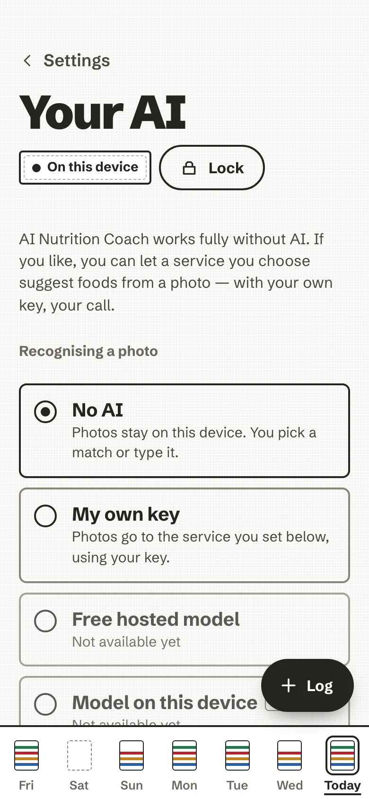

# Your AI

AI Nutrition Coach works fully without AI. Typing, barcodes, describing a meal in words, pasting a recipe, saved
meals, the coach's questions and the week's review all run on the device. An AI adds three things, each with its
own yes: recognising a photo, a smarter *Describe* (and voice), and coach notes and answers written by the AI.

Everything here lives in **Settings → Your AI**.

<!-- anc-video:your-ai -->

  
  

    
In video

    
<a href="/ai-nutrition-coach/video/your-ai/">Your AI, your call</a>

    
No AI, this server's AI or your own key, and a yes for each use.

  

<!-- /anc-video -->

<figure markdown>
{ .anc-phone loading=lazy }
<figcaption>Your AI: one choice at a time, and a switch per use.</figcaption>
</figure>

## Three choices, one at a time

| Choice | What it means |
| --- | --- |
| **No AI** | The default. Nothing is sent to any AI. Photos are not analysed; you pick a match or type it. |
| **Provided by this server** | Shown only when whoever runs your server has put one AI key on it. You need no key: a request goes to this server, which adds its own key and passes it on to the provider it names. The key never reaches your browser. |
| **My own key** | Any OpenAI-compatible service (OpenRouter, OpenAI, or a model on your own machine at `http://localhost`): its address, a model name and your API key. |

Two more choices are listed as *Not available yet*: a free hosted model and a model running on the device. They are
planned, not built.

### Setting up your own key

1. Choose **My own key**.
2. **Endpoint**: the service's address, starting with `https://` (for example `https://openrouter.ai/api/v1`).
   Plain `http://` works only for a model on this device, at `localhost`.
3. **Model**: the model name your service offers.
4. **API key**: paste it and save. It is kept inside your encrypted store, with your data, and can be read only after
   you unlock. It is sent only to the endpoint above, and is never shown again (only its last four characters).
5. **Test connection** checks that the endpoint, the model and the key work together.

The key is bound to the host you saved it for: change the endpoint to another service and the old key is not sent
there; the app asks for the key of the new one. An optional **Voice model** (for example `whisper-1`) turns a short
recording into text for *Describe*; if your service has none, the microphone button stays hidden.

If you host the app yourself, the browser only lets it reach an AI service that the server's
Content-Security-Policy lists: see [Self-host](../self-host.md#content-security-policy-and-your-ai-endpoint).

## A yes for each use

Choosing an AI sends nothing by itself. Each use has its own consent, recorded for one destination and cleared when
the destination changes:

- **Photos.** *Ask before every photo upload* is on by default: each photo shows a card naming the service, what is
  sent and what the service also sees, with *Send this photo* or *Not now*. Turn it off and you say yes once per
  service instead, and can revoke it in the same screen.
- **Describing a meal.** *Let the AI read what I describe*: the text you write or dictate (500 characters at most),
  a recipe you paste (8,000 at most) or a short recording (30 seconds at most, turned into text and not stored).
  Off, *Describe* matches your words on the device.
- **Coaching.** *Let the AI write coach notes and answer questions*, off by default. On, after you log a plate and
  when you ask the coach, your meal data goes to the AI. What exactly is listed in [The coach](coach.md).

## What happens to a photo

- It is **shrunk** in the browser, to at most 1024 × 1024.
- Its **location and camera details are removed** by the app itself, at the one place a photo can leave: EXIF and
  XMP in a JPEG, the text and time chunks of a PNG, the EXIF and XMP chunks of a WebP. A file whose metadata cannot
  be removed safely (a HEIC photo, for example) is **not sent**.
- It is sent with a fixed instruction asking which foods are on the plate, in the app's language, and the model
  name. Not your name, your history or your other plates.
- It is **not kept**: there is no "last photo" anywhere.

Like any website, the service also sees your internet address and your browser type, and may keep requests under its
own terms. The consent card says so, and so does the in-app privacy page.

## When the AI is busy or says no

The meal still lands. A busy or unreachable service is said in a plain sentence ("The AI is busy. Try again in a
moment."), never with a countdown, and the closest matches and *Type it* are right there.

The complete reference, with every field of every request and the tests that pin them, is
[AI tiers, in detail](../ai-tiers.md).
