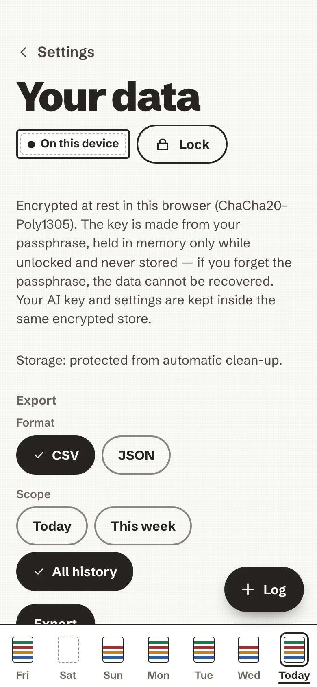

# Back up, export, erase

Your history lives in one place: an encrypted store in the browser you use. The server that hands out the app holds
none of it and cannot back it up. This page is what you can do about that, all in **Settings → Your data**. How the
store is protected is in [How it is secured](../security.md), and every technical detail in
[Data protection, in detail](../your-data.md).

<!-- anc-video:your-data -->

  
  

    
In video

    
<a href="/ai-nutrition-coach/video/your-data/">Your data, on your device</a>

    
The passphrase, the lock, an encrypted backup, exports and erase.

  

<!-- /anc-video -->

<figure markdown>
{ .anc-phone loading=lazy }
<figcaption>Settings, Your data.</figcaption>
</figure>

## Your passphrase and the lock

The passphrase you chose on the first screen makes the key that encrypts your store. The key is held in memory only
while the app is unlocked, and never written anywhere.

- **Lock** closes the store at once.
- **Lock automatically after** 5, 15, 30 minutes or 1 hour without use (15 minutes unless you change it). The app
  also locks when its page has been hidden for 5 minutes.
- The app opens in one tab at a time; another tab asks you to lock or close the first.

!!! note "A forgotten passphrase cannot be recovered"
    There is no copy, no reset link and no escrow: not by the project, not by anyone. The unlock screen offers
    *Erase and start over*. If you saved an encrypted backup, you can restore it into the new store with the
    backup's passphrase. A password manager is a good home for both.

## Encrypted backup

**Save an encrypted backup** writes one file (`.ancvault`) to wherever you choose to save it. Nothing is uploaded.

- It holds your plates, coach notes, saved meals, recipes, profile and language.
- It never holds your AI key, your AI settings or your consents.
- It is locked with a **backup passphrase** you type twice. Using the same one as the app's means one thing to
  remember; any passphrase works. If you forget it, the file cannot be opened.
- It is sealed with Argon2id and AES-256-GCM, and says nothing about its contents but its size.

The screen notes the date of your last export or backup. When it has been a while, or when you have never saved a
copy, a quiet line suggests one, with *Set up a backup* and *Not now*.

## Restore

Two places, one behaviour:

- in **Your data**, *Restore from a backup* on a device you already use;
- on the **first screen** of a new device or browser, *Restore from a backup* instead of creating a passphrase. There
  the backup's passphrase also becomes the one that unlocks the app on this device, so it needs at least 10
  characters.

Choose the file, enter its passphrase, and the backup is **merged** with what is already there. Nothing is removed
because it is missing from the file, and a plate you removed before the backup was made stays removed. If the
passphrase is wrong, the file is damaged or it is not a backup, the app says so and **nothing is changed**.

This is also how you carry your history from a phone to a laptop: devices do not sync yet. An encrypted relay for
that is planned in the [roadmap](https://github.com/mmornati/ai-nutrition-coach/blob/main/docs/encrypted-sync-plan.md),
and not built.

## Export

**Export** writes your plates as a plain file for your own use: **CSV** (one row per food) or **JSON** (plates,
profile, saved meals and recipes), for today, this week or all your history. It works offline.

Exports are **plain, unencrypted files**, and the app says so under the button: keep them somewhere you trust. They
cannot be imported back; the encrypted backup is the way back.

## Remove one plate, or erase everything

- **One plate**: open it from Today and choose *Remove this plate*. It goes from your history on this device, along
  with its coach note.
- **Everything**: *Erase all local data* asks once ("Erase everything on this device?") and then deletes your plates,
  coach notes, saved AI key and any exports still on this device, for good. It cannot reach a file you already
  downloaded or shared, or a backup file you saved elsewhere: delete those yourself.

## Two things worth knowing

- **On iPhone, install first, then log.** An app added to the Home Screen keeps its data apart from Safari's. If you
  logged in Safari before installing, your plates are still in Safari: save an encrypted backup there and restore it
  in the installed app.
- **A shared browser profile is a shared history.** Everyone who can open the app in that browser profile and knows
  the passphrase sees the same plates. For separate histories, use a separate device or browser profile, each with
  its own passphrase.
